# Dobot TCP/IP 二次开发接口参考（V4.5.1）

> 适用：Dobot 六轴工业机械臂 V4 控制柜；文档版本 V4.5.1，修订日期 2024-08-15。
> 本文件以中文版为完整正文依据，核对英文版通信协议与关键接口，补充阅读导航及原文疑点。示例来自原手册，均为说明接口用法的伪代码，不能直接当作可运行程序。

## 来源与阅读方式

- 中文原件：[Dobot TCP_IP二次开发接口文档V4.5.1_20240815_cn.pdf](<E:/TCP-IP-Protocol-6AXis-V4-main/Dobot TCP_IP二次开发接口文档V4.5.1_20240815_cn.pdf>)（108 页）。
- 英文原件：[Dobot TCP_IP Remote Control Interface Guide V4.5.1_20240815_en.pdf](<E:/TCP-IP-Protocol-6AXis-V4-main/Dobot TCP_IP Remote Control Interface Guide V4.5.1_20240815_en.pdf>)（110 页）。
- 下方页码均指中文 PDF 的物理页码，便于回查；全文保留参数、范围、返回值、示例、反馈字段与错误码。表格使用等宽文本保留原始列布局，避免跨页内容被错误合并。
- 插图另存于同目录的 `assets/dobot_tcp_ip_v4_5_1/`，与本文一起保留即可显示。

## 通信协议速查（整理）

| 端口 | 用途 | 周期或格式 |
| --- | --- | --- |
| 29999 | Dashboard：发送控制指令、主动查询状态 | 字符串命令与应答 |
| 30004 | 接收机器人实时状态 | 每 8 ms；每包 1440 字节 |
| 30005 | 接收机器人状态 | 每 200 ms；每包 1440 字节 |
| 30006 | 可配置状态反馈 | 默认周期原文有冲突，见下节；每包 1440 字节 |

Dashboard 是控制指令通道的名称。发送格式为 `Command(param1,param2,...)`，指令名称不区分大小写；参数使用英文逗号分隔，完整命令以右括号结束。应答格式为：

```text
ErrorID,{value,...,valueN},Command(param1,param2,...);
```

`ErrorID=0` 表示命令接收成功，不能据此断定运动已经完成。部分指令返回 `ResultID`（排队执行的指令编号），需结合 `GetCurrentCommandID()` 和机器人状态判断完成情况，详见对应接口。

状态反馈采用小端字节序，即一个数的低位字节先存放。TCP 是连续的字节流，一次网络读取不保证正好是一整包；实现时应按 1440 字节组包（此项为开发说明）。常规命令按 ASCII 字符串发送；`RunScript` 工程名含中文时，原文要求发送端使用 UTF-8。

常见术语：关节坐标是六个关节的角度；位姿是末端的位置与朝向；工具中心点（Tool Center Point，也缩写为 TCP）指工具上选定的工作点，与通信协议 TCP 含义不同。`pose={x,y,z,rx,ry,rz}` 表示位置和旋转角，`joint={j1,j2,j3,j4,j5,j6}` 表示六个关节角。位置通常使用 mm、角度使用度，具体以接口参数表为准。

## 原文不一致与使用注意（整理）

以下均保留原文，不擅自修改协议定义：

- **30006 默认周期**：中英文概述均写 50 ms，实时反馈章节写 1000 ms；需以实际控制器配置或厂商确认为准。
- **EnableRobot 原型**：原型行列出四个参数，参数表、返回值及示例还支持第五个 `isCheck`；原文允许 0、1、4、5 个参数。
- **反馈字段偏移**：中文第 103 页 `J5ApproachState` 和 `J6ApproachState` 均写 1041；按相邻布局推测后者应为 1042，但这是推测，使用前应核实。
- **反馈长度与保留位**：第 100 页 0072–0087 占 16 字节，大小栏却写 8；第 104 页末尾保留位写 1418–1440、大小 22，与 1440 字节总长不符；按长度推算末尾应到 1439。`AutoManualMode` 同时标注 `char`、数量 1 和大小 2，也应核实。
- **示例笔误**：清错示例出现 `if(robotMode=9)`；判断应使用比较而非赋值。队列示例出现 `GetCurrentCommndID()`，接口标题为 `GetCurrentCommandID()`。抱闸说明将二进制 `00000100` 对应的十六进制写为 `0x03`，实际应为 `0x04`。
- **ServoJ / ServoP**：原文规定 `t` 范围为 0.02–3600 s、默认 0.1 s；示例又写 30 ms 循环下发。调用周期和单点运行时间是两个概念，不能把反馈周期直接视为可用的伺服周期。
- **运行完成判断**：下发成功与执行完成分开处理；第 98 页给出结合队列 ID 和 `RobotMode=5`（使能且空闲）判断的示例。

## 正文导航

- [前言](#manual-preface)
- [概述](#manual-overview)
- [控制相关指令](#manual-21)
- [设置相关指令](#manual-22)
- [计算和获取相关指令](#manual-23)
- [IO 相关指令](#manual-24)
- [Modbus 相关指令](#manual-25)
- [总线寄存器相关指令](#manual-26)
- [运动相关指令](#manual-27)
- [实时反馈信息](#manual-feedback)
- [通用错误码](#manual-errors)

## 接口索引

| 指令 | 中文 PDF 页码 |
| --- | --- |
| [PowerOn](#cmd-poweron) | 7 |
| [EnableRobot](#cmd-enablerobot) | 8 |
| [DisableRobot](#cmd-disablerobot) | 9 |
| [ClearError](#cmd-clearerror) | 9 |
| [RunScript](#cmd-runscript) | 10 |
| [Stop](#cmd-stop) | 11 |
| [Pause](#cmd-pause) | 11 |
| [Continue](#cmd-continue) | 12 |
| [EmergencyStop](#cmd-emergencystop) | 12 |
| [BrakeControl](#cmd-brakecontrol) | 13 |
| [StartDrag](#cmd-startdrag) | 14 |
| [StopDrag](#cmd-stopdrag) | 14 |
| [SpeedFactor](#cmd-speedfactor) | 16 |
| [User](#cmd-user) | 16 |
| [SetUser](#cmd-setuser) | 17 |
| [CalcUser](#cmd-calcuser) | 18 |
| [Tool](#cmd-tool) | 19 |
| [SetTool](#cmd-settool) | 20 |
| [CalcTool](#cmd-calctool) | 21 |
| [SetPayload](#cmd-setpayload) | 22 |
| [AccJ](#cmd-accj) | 23 |
| [AccL](#cmd-accl) | 24 |
| [VelJ](#cmd-velj) | 24 |
| [VelL](#cmd-vell) | 25 |
| [CP](#cmd-cp) | 26 |
| [SetCollisionLevel](#cmd-setcollisionlevel) | 26 |
| [SetBackDistance](#cmd-setbackdistance) | 27 |
| [SetPostCollisionMode](#cmd-setpostcollisionmode) | 28 |
| [DragSensivity](#cmd-dragsensivity) | 28 |
| [EnableSafeSkin](#cmd-enablesafeskin) | 29 |
| [SetSafeSkin](#cmd-setsafeskin) | 30 |
| [SetSafeWallEnable](#cmd-setsafewallenable) | 30 |
| [SetWorkZoneEnable](#cmd-setworkzoneenable) | 31 |
| [RobotMode](#cmd-robotmode) | 33 |
| [PositiveKin](#cmd-positivekin) | 34 |
| [InverseKin](#cmd-inversekin) | 35 |
| [GetAngle](#cmd-getangle) | 36 |
| [GetPose](#cmd-getpose) | 37 |
| [GetErrorID](#cmd-geterrorid) | 37 |
| [CreateTray](#cmd-createtray) | 38 |
| [GetTrayPoint](#cmd-gettraypoint) | 40 |
| [DO](#cmd-do) | 43 |
| [DOInstant](#cmd-doinstant) | 43 |
| [GetDO](#cmd-getdo) | 44 |
| [DOGroup](#cmd-dogroup) | 45 |
| [GetDOGroup](#cmd-getdogroup) | 45 |
| [ToolDO](#cmd-tooldo) | 46 |
| [ToolDOInstant](#cmd-tooldoinstant) | 47 |
| [GetToolDO](#cmd-gettooldo) | 47 |
| [AO](#cmd-ao) | 48 |
| [AOInstant](#cmd-aoinstant) | 49 |
| [GetAO](#cmd-getao) | 49 |
| [DI](#cmd-di) | 50 |
| [DIGroup](#cmd-digroup) | 50 |
| [ToolDI](#cmd-tooldi) | 51 |
| [AI](#cmd-ai) | 52 |
| [ToolAI](#cmd-toolai) | 52 |
| [SetTool485](#cmd-settool485) | 53 |
| [SetToolPower](#cmd-settoolpower) | 54 |
| [SetToolMode](#cmd-settoolmode) | 55 |
| [ModbusCreate](#cmd-modbuscreate) | 57 |
| [ModbusRTUCreate](#cmd-modbusrtucreate) | 58 |
| [ModbusClose](#cmd-modbusclose) | 59 |
| [GetInBits](#cmd-getinbits) | 60 |
| [GetInRegs](#cmd-getinregs) | 60 |
| [GetCoils](#cmd-getcoils) | 61 |
| [SetCoils](#cmd-setcoils) | 62 |
| [GetHoldRegs](#cmd-getholdregs) | 63 |
| [SetHoldRegs](#cmd-setholdregs) | 64 |
| [GetInputBool](#cmd-getinputbool) | 65 |
| [GetInputInt](#cmd-getinputint) | 66 |
| [GetInputFloat](#cmd-getinputfloat) | 66 |
| [GetOutputBool](#cmd-getoutputbool) | 67 |
| [GetOutputInt](#cmd-getoutputint) | 67 |
| [GetOutputFloat](#cmd-getoutputfloat) | 68 |
| [SetOutputBool](#cmd-setoutputbool) | 69 |
| [SetOutputInt](#cmd-setoutputint) | 69 |
| [SetOutputFloat](#cmd-setoutputfloat) | 70 |
| [MovJ](#cmd-movj) | 77 |
| [MovL](#cmd-movl) | 78 |
| [MovLIO](#cmd-movlio) | 79 |
| [MovJIO](#cmd-movjio) | 81 |
| [Arc](#cmd-arc) | 83 |
| [Circle](#cmd-circle) | 84 |
| [ServoJ](#cmd-servoj) | 85 |
| [ServoP](#cmd-servop) | 86 |
| [MoveJog](#cmd-movejog) | 88 |
| [RunTo](#cmd-runto) | 89 |
| [GetStartPose](#cmd-getstartpose) | 90 |
| [StartPath](#cmd-startpath) | 91 |
| [RelMovJTool](#cmd-relmovjtool) | 92 |
| [RelMovLTool](#cmd-relmovltool) | 93 |
| [RelMovJUser](#cmd-relmovjuser) | 94 |
| [RelMovLUser](#cmd-relmovluser) | 95 |
| [RelJointMovJ](#cmd-reljointmovj) | 96 |
| [GetCurrentCommandID](#cmd-getcurrentcommandid) | 97 |

---

<!-- 中文 PDF 第 3 页 -->

<a id="manual-preface"></a>

## 前言

**目的**

本手册介绍了Dobot工业机械臂控制柜V4版本TCP/IP二次开发接口及其使用方式，帮助用户了解
和开发基于TCP/IP的机械臂控制软件。

**读者对象**

本手册适用于：

客户
   销售工程师
   安装调测工程师
   技术支持工程师

**修订记录**

```text
 时间          版本      修订记录
             号

 2024/08/15  V4.5.1  修正ServoJ指令示例，补充ServoJ和ServoP的返回值。

 2024/03/25  V4.5.1  对应六轴机械臂控制器4.5.1版本

 2023/10/19  V4.5.0  对应六轴机械臂控制器4.5.0版本，新增CreateTray、
                     GetTrayPoint、ServoJ、ServoP指令，优化部分说明

 2023/07/26  V4.4.0  对应六轴机械臂控制器4.4.0版本

 2023/05/12  V4.3.0  对应六轴机械臂控制器4.3.0版本

 2023/02/17  V4.2.0  对应六轴机械臂控制器4.2.0版本
```

<!-- 中文 PDF 第 4 页 -->

<a id="manual-overview"></a>

## 1 概述

由于基于TCP/IP的通讯具有成本低、可靠性高、实用性强、性能高等特点，许多工业自动化项目
对基于TCP/IP协议控制机器人的需求广泛，因此Dobot机器人在TCP/IP协议的基础上，提供了丰
富的接口用于与外部设备的交互。

端口说明

根据设计，Dobot机器人会开启29999、30004、30005以及30006服务器端口；

29999服务器端口：上位机可以通过29999端口直接发送控制指令给机器人，或者主动获取机
   器人的某些状态，这些功能被称为Dashboard。

30004、30005以及30006服务器端口：30004端口即实时反馈端口，客户端每8ms能收到一
   次机器人实时状态信息。30005端口每200ms反馈机器人的信息。30006端口为可配置的反
   馈机器人信息端口(默认为每50ms反馈，如需修改，请联系技术支持)。通过实时反馈端口每
   次收到的数据包有1440个字节，这些字节以标准的格式排列。

消息格式

消息命令与消息应答都是 ASCII 码格式(字符串形式)。

上位机下发消息格式如下：

消息名称(Param1,Param2,Param3……ParamN)

由消息名称和参数组成，参数放在括号内， 每一个参数之间以英文逗号 ”,” 相隔，一个完整的
消息以右括号结束。

TCP/IP远程控制指令不区分大小写格式，如以下三种写法都会被识别为使能机器人的指令：

```text
   ENABLEROBOT()
   enablerobot()
   eNabLErobOt()
机器人收到命令后，会返回应答消息，格式如下：

 ErrorID,{value,...,valueN},消息名称(Param1,Param2,Param3……ParamN);

    ErrorID 为0时表示命令接收成功，返回非0则代表命令有错误，详见通用错误码；
```

{value,...,valueN} 表示返回值，没有返回值则返回{}；

消息名称(Param1,Param2,Param3……ParamN) 为下发的命令消息。
例如：

<!-- 中文 PDF 第 5 页 -->

下发:

```text
 MovL(-500,100,200,150,0,90)
```

返回：

0,{},MovL(-500,100,200,150,0,90);

0表示接收成功，{}表示没有返回值。

下发：

```text
 Mov(-500,100,200,150,0,90)
```

返回：

-10000,{},Mov(-500,100,200,150,0,90);

-10000表示命令不存在，{}表示没有返回值。

本文档中的示例均为伪代码，无法直接运行，仅用于说明如何使用接口。

<!-- 中文 PDF 第 6 页 -->

<a id="manual-commands"></a>

## 2 通用指令

2.1 控制相关指令
   2.2 设置相关指令
   2.3 计算和获取相关指令
   2.4 IO相关指令
   2.5 Modbus相关指令
   2.6 总线寄存器相关指令
   2.7 运动相关指令

<!-- 中文 PDF 第 7 页 -->

<a id="manual-21"></a>

## 2.1 控制相关指令

指令列表

| 指令 | 功能 |
| --- | --- |
| `PowerOn` | 机械臂上电 |
| `EnableRobot` | 使能机械臂 |
| `DisableRobot` | 下使能机械臂 |
| `ClearError` | 清除机器人报警 |
| `RunScript` | 运行指定工程 |
| `Stop` | 停止运动（或正在运行的工程） |
| `Pause` | 暂停运动（或正在运行的工程） |
| `Continue` | 继续运动（或已暂停的工程） |
| `EmergencyStop` | 紧急停止机械臂 |
| `BrakeControl` | 控制指定关节的抱闸 |
| `StartDrag` | 机械臂进入关节拖拽模式 |
| `StopDrag` | 机械臂退出拖拽模式 |


<a id="cmd-poweron"></a>

### PowerOn

**原型**

```text
 PowerOn()
```

**描述**

机械臂上电。机械臂上电到完成，需要大概10秒钟的时间，然后再进行使能操作。请勿在机器人
开机初始化完成前下发控制信号，否则可能会造成机器人异常动作。

**返回**

```text
 ErrorID,{},PowerOn();
```

**示例**

```text
 PowerOn()
```

<!-- 中文 PDF 第 8 页 -->

控制机器人上电。

<a id="cmd-enablerobot"></a>

### EnableRobot

**原型**

```text
 EnableRobot(load,centerX,centerY,centerZ)
```

**描述**

使能机械臂。

**可选参数**

```text
  参数名      类型                            说明

 load     double   设置负载重量，取值范围不能超过各个型号机器人的负载范围。单
                   位：kg

 centerX  double   X方向偏心距离。取值范围：-999~ 999，单位：mm

 centerY  double   Y方向偏心距离。取值范围：-999~ 999，单位：mm

 centerZ  double   Z方向偏心距离。取值范围：-999~ 999，单位：mm

                   是否检查负载。1表示检查，0表示不检查。如果设置为1，则机械臂
 isCheck  int      使能后会检查实际负载是否和设置负载一致，如果不一致会自动下使
                   能。默认值为0
```

可携带的参数数量如下：

0：不携带参数，表示使能时不设置负载重量和偏心参数。
   1：携带一个参数，该参数表示负载重量。
   4：携带四个参数，分别表示负载重量和偏心参数。
   5：携带五个参数，分别表示负载重量、偏心参数和是否检查负载。
返回

```text
 ErrorID,{},EnableRobot(load,centerX,centerY,centerZ,isCheck);
```

**示例1**

```text
 EnableRobot()
```

使能机器人，不设置负载重量和偏心参数。

**示例2**

<!-- 中文 PDF 第 9 页 -->

```text
EnableRobot(1.5)
```

使能机器人并设置负载重量1.5kg。

**示例3**

```text
 EnableRobot(1.5,0,0,30.5)
```

使能机器人并设置负载重量1.5kg，Z方向偏心30.5mm，不检查负载。

**示例4**

```text
 EnableRobot(1.5,0,0,30.5,1)
```

使能机器人并设置负载重量1.5kg，Z方向偏心30.5mm，检查负载。

<a id="cmd-disablerobot"></a>

### DisableRobot

**原型**

```text
 DisableRobot()
```

**描述**

下使能机械臂。

**返回**

```text
 ErrorID,{},DisableRobot();
```

**示例**

```text
 DisableRobot()
```

下使能机械臂。

<a id="cmd-clearerror"></a>

### ClearError

**原型**

```text
 ClearError()
```

**描述**

<!-- 中文 PDF 第 10 页 -->

清除机器人报警。清除报警后，用户可以根据RobotMode来判断机器人是否还处于报警状态。部
分报警需要解决报警原因或者重启控制柜后才能清除。

**返回**

```text
 ErrorID,{},ClearError();
```

**示例**

```text
 uint64_t  robotMode  =  parseRobotMode(RobotMode());  //  parseRobotMode用于获取RobotMode指令返回的值
 ，请自行实现
 if(robotMode=9){
     ClearError()
 }
```

清除机器人报警。

<a id="cmd-runscript"></a>

### RunScript

**原型**

```text
 RunScript(projectName)
```

**描述**

运行指定工程。如果需要运行工程后立即暂停，则需要在下发RunScript指令后至少间隔1s再下发
Pause指令。

**必选参数**

```text
    参数名          类型      说明

                         工程文件的名称。
 projectName    string   如果名称包含中文，必须将发送端的编码方式设置为UTF-8，否
                         则会导致中文接收异常。如果名称为纯数字，则需加上双引号。
```

**返回**

```text
 ErrorID,{},RunScript(projectName);
```

**示例1**

```text
 RunScript(demo)
```

运行名称为demo的脚本工程。

<!-- 中文 PDF 第 11 页 -->

**示例2**

```text
 RunScript("123")
```

运行名称为123的脚本工程。

**示例3**

```text
 RunScript("blockly_test")
```

DobotStudio Pro在保存积木编程工程时会自动添加“blockly_”前缀。例如在DobotStudio Pro
中保存了一个名为“test”的积木编程工程，则执行该指令时工程名称需要指定
为"blockly_test"。

<a id="cmd-stop"></a>

### Stop

**原型**

```text
 Stop()
```

**描述**

停止已下发的运动指令队列或者RunScript指令运行的工程。

**返回**

```text
 ErrorID,{},Stop();
```

**示例**

```text
 Stop()
```

停止运动。

<a id="cmd-pause"></a>

### Pause

**原型**

```text
 Pause()
```

**描述**

暂停已下发的运动指令队列或者RunScript指令运行的工程。

<!-- 中文 PDF 第 12 页 -->

**返回**

```text
 ErrorID,{},Pause();
```

**示例**

```text
 Pause()
```

暂停运动。

<a id="cmd-continue"></a>

### Continue

**原型**

```text
 Continue()
```

**描述**

继续已暂停的运动指令队列或者RunScript指令运行的工程。

**返回**

```text
 ErrorID,{},Continue();
```

**示例**

```text
 Continue()
```

继续运动。

<a id="cmd-emergencystop"></a>

### EmergencyStop

**原型**

```text
 EmergencyStop(mode)
```

**描述**

紧急停止机械臂。急停后机械臂会下使能并报警，需要松开急停、清除报警后才能重新使能。

**必选参数**

```text
   参数名       类型      说明
```

<!-- 中文 PDF 第 13 页 -->

```text
mode       int      急停操作模式。1表示按下急停，0表示松开急停
```

**返回**

```text
 ErrorID,{},EmergencyStop(mode);
```

**示例**

```text
 EmergencyStop(1)
```

紧急停止机器人。

<a id="cmd-brakecontrol"></a>

### BrakeControl

**原型**

```text
 BrakeControl(axisID,value)
```

**描述**

控制指定关节的抱闸。机械臂静止时关节会自动抱闸，如果用户需进行关节拖拽操作，可开启抱
闸，即在机械臂下使能状态，手动扶住关节后，下发开启抱闸的指令。

仅能在机器人下使能时控制关节抱闸，否则ErrorID会返回-1。

**必选参数**

```text
  参数      类    说明
   名      型

 axisID  int   关节轴序号，1表示J1轴，2表示J2轴，以此类推

 value   int   设置抱闸状态。0表示抱闸锁死（关节不可移动），1表示松开抱闸（关节
               可移动）
```

**返回**

```text
 ErrorID,{},BrakeControl(axisID,value);
```

**示例**

```text
 BrakeControl(1,1)
```

松开关节1的抱闸。

<!-- 中文 PDF 第 14 页 -->

<a id="cmd-startdrag"></a>

### StartDrag

**原型**

```text
 StartDrag()
```

**描述**

机械臂进入关节拖拽模式。机械臂处于报警状态下时，无法通过该指令进入关节拖拽模式。

**返回**

```text
 ErrorID,{},StartDrag();
```

**示例**

```text
 StartDrag()
```

机械臂进入关节拖拽模式。

<a id="cmd-stopdrag"></a>

### StopDrag

**原型**

```text
 StopDrag()
```

**描述**

机械臂退出拖拽模式。关节拖拽和力控拖拽均使用此指令退出。

**返回**

```text
 ErrorID,{},StopDrag();
```

**示例**

```text
 StopDrag()
```

机械臂退出拖拽模式。

<!-- 中文 PDF 第 15 页 -->

<a id="manual-22"></a>

## 2.2 设置相关指令

指令列表

| 指令 | 功能 |
| --- | --- |
| `SpeedFactor` | 设置全局速度比例 |
| `User` | 设置全局用户坐标系 |
| `SetUser` | 修改指定的用户坐标系 |
| `CalcUser` | 计算用户坐标系 |
| `Tool` | 设置全局工具坐标系 |
| `SetTool` | 修改指定的工具坐标系 |
| `CalcTool` | 计算工具坐标系 |
| `SetPayload` | 设置机械臂末端负载 |
| `AccJ` | 设置关节运动方式的加速度比例 |
| `AccL` | 设置直线和弧线运动方式的加速度比例 |
| `VelJ` | 设置关节运动方式的速度比例 |
| `VelL` | 设置直线和弧线运动方式的速度比例 |
| `CP` | 设置平滑过渡比例 |
| `SetCollisionLevel` | 设置碰撞检测等级 |
| `SetBackDistance` | 设置碰撞回退距离 |
| `SetPostCollisionMode` | 设置碰撞后处理方式 |
| `DragSensivity` | 设置拖拽灵敏度 |
| `EnableSafeSkin` | 开启或关闭安全皮肤功能 |
| `SetSafeSkin` | 设置安全皮肤各个部位的灵敏度 |
| `SetSafeWallEnable` | 开启或关闭指定的安全墙 |
| `SetWorkZoneEnable` | 开启或关闭指定的安全区域 |


说明：
 如无特殊说明，TCP指令设置的参数均只在本次TCP/IP控制模式中生效。

**原文插图（第 15 页）**


<!-- 中文 PDF 第 16 页 -->

<a id="cmd-speedfactor"></a>

### SpeedFactor

**原型**

```text
 SpeedFactor(ratio)
```

**描述**

设置全局速度比例。

机械臂点动时实际运动加速度/速度比例 = 控制软件点动设置中的值 x 全局速度比例。

例：控制软件设置的关节速度为12°/s，全局速率为50%，则实际点动速度为12°/s x 50% =
   6°/s

机械臂再现时实际运动加速度/速度比例 = 运动指令可选参数设置的比例 x 控制软件再现设置
   中的值 x 全局速度比例。

例：控制软件设置的坐标系速度为2000mm/s，全局速率为50%，运动指令设置的速率为
   80%，则实际运动速度为2000mm/s x 50% x 80% = 800mm/s

未设置时沿用进入TCP/IP控制模式前控制软件设置的值。

**必选参数**

```text
   参数名         类型      说明

 ratio       int       全局运动速度比例，取值范围：[1, 100]
```

**返回**

```text
 ErrorID,{},SpeedFactor(ratio);
```

**示例**

```text
 SpeedFactor(80)
```

设置全局运动速度比例为80%。

<a id="cmd-user"></a>

### User

**原型**

```text
 User(index)
```

**描述**

<!-- 中文 PDF 第 17 页 -->

设置全局用户坐标系。用户下发运动指令时可选择用户坐标系，如未指定，则会使用全局用户坐标
系。

未设置时默认的全局用户坐标系为用户坐标系0。

**必选参数**

```text
  参数     类   说明
  名      型

 index  int  已标定的用户坐标系索引。需要通过控制软件等方式标定后才可在此处通过
             索引选择。
```

**返回**

```text
 ErrorID,{ResultID},User(index);
```

若ErrorID返回-1，表示设置的用户坐标索引索引不存在；ResultID为算法队列ID，可用于判断指
令执行顺序。

**示例**

```text
 User(1)
```

设置用户坐标系1为全局用户坐标系。

<a id="cmd-setuser"></a>

### SetUser

原型：

```text
 SetUser(index,table,type)
```

描述:

修改指定的用户坐标系。

必选参数：

```text
  参数     类型    说明
  名

 index  int    已标定的用户坐标系索引。需要通过控制软件等方式标定后才可在此处
               通过索引选择。

 table  string 修改后的用户坐标系，格式为{x, y, z, rx, ry, rz}，建议使用CalcUser指令
               获取。
```

可选参数：

<!-- 中文 PDF 第 18 页 -->

```text
参数      类    说明
   名      型

               是否全局保存。
 type    int   0：该命令修改的坐标系仅在当前工程运行中生效，退出tcp模式后恢复为原
               来的值。
               1：该命令修改的坐标系全局保存，退出tcp模式后依然保持修改后的值。
```

返回：

```text
 ErrorID,{},SetUser(index,table,type);
```

示例：

```text
 SetUser(1,{10,10,10,0,0,0})
```

修改用户坐标系1为X=10，Y=10，Z=10，RX=0，RY=0，RZ=0。

<a id="cmd-calcuser"></a>

### CalcUser

原型：

```text
 CalcUser(index,matrix_direction,table)
```

描述:

计算用户坐标系。

必选参数：

```text
     参数名           类型      说明

 index             int     已标定的用户坐标系索引。需要通过控制软件等方式标定后
                           才可在此处通过索引选择。

                           计算的方向。
                           1表示左乘，即index指定的坐标系沿基坐标系偏转table指定
 matrix_direction  int     的值；
                           0表示右乘，即index指定的坐标系沿自己偏转table指定的
                           值。

 table             string  用户坐标系偏移值，格式为{x, y, z, rx, ry, rz}。
```

返回：

```text
 ErrorID,{x,y,z,rx,ry,rz},CalcUser(index,matrix_direction,table);
```

<!-- 中文 PDF 第 19 页 -->

其中{x, y, z, rx, ry, rz}为计算得出的用户坐标系。

示例1：

```text
 newUser  =  CalcUser(1,1,{10,10,10,10,10,10})
```

计算用户坐标系1左乘{10,10,10,0,0,0}后的值。计算过程可等价为：一个初始位姿与用户坐标系1
相同的坐标系，沿基坐标系平移{x=10, y=10, z=10}并旋转{rx=10, ry=10, rz=10}后，得到的新
坐标系为newUser。

示例2：

```text
 newUser  =  CalcUser(1,0,{10,10,10,10,10,10})
```

计算用户坐标系1右乘{10,10,10,0,0,0}后的值。计算过程可等价为：一个初始位姿与用户坐标系1
相同的坐标系，沿用户坐标系1平移{x=10, y=10, z=10}并旋转{rx=10, ry=10, rz=10}后，得到的
新坐标系为newUser。

<a id="cmd-tool"></a>

### Tool

**原型**

```text
 Tool(index)
```

**描述**

设置全局工具坐标系。用户下发运动指令时可选择工具坐标系，如未指定，则会使用全局工具坐标
系。

未设置时默认的全局工具坐标系为工具坐标系0。

**必选参数**

```text
  参数      类    说明
   名      型

 index   int   已标定的工具坐标系索引。需要通过控制软件等方式标定后才可在此处通过
               索引选择。
```

**返回**

```text
 ErrorID,{ResultID},Tool(index);
```

若ErrorID返回-1，表示设置的工具坐标索引索引不存在；ResultID为算法队列ID，可用于判断指
令执行顺序。

<!-- 中文 PDF 第 20 页 -->

**示例**

```text
 Tool(1)
```

设置工具坐标系1为全局工具坐标系。

<a id="cmd-settool"></a>

### SetTool

原型：

```text
 SetTool(index,table,type)
```

描述:

修改指定的工具坐标系。

必选参数：

```text
  参数     类型     说明
  名

 index   int    已标定的工具坐标系索引。需要通过控制软件等方式标定后才可在此处
                通过索引选择。

 table   string 修改后的工具坐标系，格式为{x, y, z, rx, ry, rz}，表示该坐标系相对默认
                工具坐标系的偏移量。
```

可选参数：

```text
 参数      类    说明
  名      型

              是否全局保存。
 type   int   0：该命令修改的坐标系仅在当前工程运行中生效，退出tcp模式后恢复为原
              来的值。
              1：该命令修改的坐标系全局保存，退出tcp模式后依然保持修改后的值。
```

返回：

```text
 ErrorID,{},SetTool(index,table,type);
```

示例：

```text
 SetTool(1,{10,10,10,0,0,0})
```

修改工具坐标系1为X=10，Y=10，Z=10，RX=0，RY=0，RZ=0。

<!-- 中文 PDF 第 21 页 -->

<a id="cmd-calctool"></a>

### CalcTool

原型：

```text
 CalcTool(index,matrix_direction,table)
```

描述:

计算工具坐标系。

必选参数：

```text
      参数名           类型      说明

 index             int      已标定的工具坐标系索引。需要通过控制软件等方式标定后
                            才可在此处通过索引选择。

                            计算的方向。
                            1表示左乘，即index指定的坐标系沿法兰坐标系偏转table指
 matrix_direction  int      定的值；
                            0表示右乘，即index指定的坐标系沿自己偏转table指定的
                            值。

 table             string   工具坐标系偏移值，格式为{x, y, z, rx, ry, rz}。
```

返回：

```text
 ErrorID,{x,y,z,rx,ry,rz},CalcTool(index,matrix_direction,table);
```

其中{x, y, z, rx, ry, rz}为计算得出的工具坐标系。

示例1：

```text
 CalcTool(1,1,{10,10,10,0,0,0})
```

计算工具坐标系1左乘{10,10,10,0,0,0}后的值。计算过程可等价为：一个初始位姿与工具坐标系1
相同的坐标系，沿法兰坐标系平移{x=10, y=10, z=10}并旋转{rx=10, ry=10, rz=10}后，得到的
新坐标系为newTool。

示例2：

```text
 CalcTool(1,0,{10,10,10,0,0,0})
```

计算工具坐标系1右乘{10,10,10,0,0,0}后的值。计算过程可等价为：一个初始位姿与工具坐标系1
相同的坐标系，沿工具坐标系1平移{x=10, y=10, z=10}并旋转{rx=10, ry=10, rz=10}后，得到的
新坐标系为newTool。

<!-- 中文 PDF 第 22 页 -->

<a id="cmd-setpayload"></a>

### SetPayload

**原型**

```text
 SetPayload(load,x,y,z)
 SetPayload(name)
```

**描述**

设置机械臂末端负载，支持两种设置方式。

方式一：直接设置负载参数

必选参数1

```text
  参数     类型     说明
  名

 load   double  设置负载重量，取值范围不能超过各个型号机器人的负载范围。单
                位：kg
```

可选参数1

```text
 参数名      类型    说明

 x      double  末端负载X轴偏心坐标。取值范围：范围：-500~500。单位：mm

 y      double  末端负载Y轴偏心坐标。取值范围：范围：-500~500。单位：mm

 z      double  末端负载Z轴偏心坐标。取值范围：范围：-500~500。单位：mm
```

需同时设置或不设置这三个参数。偏心坐标为负载（含治具）的质心在默认工具坐标系下的坐标，
参考下图。

方式二：通过控制软件保存的预设负载参数组设置

必选参数2

```text
   参数名        类型      说明

 name       string    控制软件保存的预设负载参数组的名称
```

**原文插图（第 22 页）**

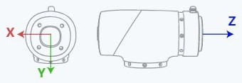

<!-- 中文 PDF 第 23 页 -->

**返回**

```text
 ErrorID,{ResultID},SetPayload(load,x,y,z);
```

ResultID为算法队列ID，可用于判断指令执行顺序。

**示例1**

```text
 SetPayload(3,10,10,10)
```

设置末端负载重量为3kg，偏心坐标为{10,10,10}。

**示例2**

```text
 SetPayload("Load1")
```

加载名称为“Load1”的预设负载参数组。

<a id="cmd-accj"></a>

### AccJ

**原型**

```text
 AccJ(R)
```

**描述**

设置关节运动方式的加速度比例。

未设置时默认值为100。

**必选参数**

```text
    参数名            类型       说明

 R              int         加速度比例。取值范围：[1,100]
```

**原文插图（第 23 页）**

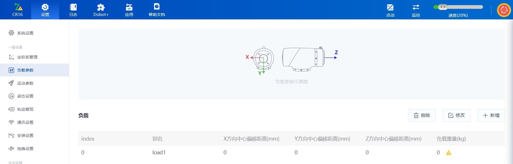

<!-- 中文 PDF 第 24 页 -->

**返回**

```text
 ErrorID,{},AccJ(R);
```

**示例**

```text
 AccJ(50)
```

设置关节运动方式的加速度比例为50%。

<a id="cmd-accl"></a>

### AccL

**原型**

```text
 AccL(R)
```

**描述**

设置直线和弧线运动方式的加速度比例。

未设置时默认值为100。

**必选参数**

```text
    参数名           类型       说明

 R             int         加速度比例。取值范围：[1,100]
```

**返回**

```text
 ErrorID,{},AccL(R);
```

**示例**

```text
 AccL(50)
```

设置直线和弧线运动方式的加速度比例为50%。

<a id="cmd-velj"></a>

### VelJ

**原型**

```text
 VelJ(R)
```

<!-- 中文 PDF 第 25 页 -->

**描述**

设置关节运动方式的速度比例。

未设置时默认值为100。

**必选参数**

```text
    参数名           类型       说明

 R              int        速度比例。取值范围：[1,100]
```

**返回**

```text
 ErrorID,{},VelJ(R);
```

**示例**

```text
 VelJ(50)
```

设置关节运动方式的速度比例为50%。

<a id="cmd-vell"></a>

### VelL

**原型**

```text
 VelL(R)
```

**描述**

设置直线和弧线运动方式的速度比例。

未设置时默认值为100。

**必选参数**

```text
    参数名           类型       说明

 R              int        速度比例。取值范围：[1,100]
```

**返回**

```text
 ErrorID,{},VelL(R);
```

**示例**

```text
 VelL(50)
```

<!-- 中文 PDF 第 26 页 -->

设置直线和弧线运动方式的速度比例为50%。

<a id="cmd-cp"></a>

### CP

**原型**

```text
 CP(R)
```

**描述**

设置平滑过渡比例，即机械臂连续运动经过多个点时，经过中间点是以直角方式过渡还是以曲线方
式过渡。

未设置时默认值为0。

**必选参数**

```text
   参数名         类型      说明

 R           int       平滑过渡比例。取值范围：[0, 100]
```

**返回**

```text
 ErrorID,{},CP(R);
```

**示例**

```text
 CP(50)
```

设置平滑过渡比例为50。

<a id="cmd-setcollisionlevel"></a>

### SetCollisionLevel

**原型**

**原文插图（第 26 页）**


<!-- 中文 PDF 第 27 页 -->

```text
SetCollisionLevel(level)
```

**描述**

设置碰撞检测等级。

未设置时沿用进入TCP/IP控制模式前控制软件设置的值。

**必选参数**

```text
  参数名      类型      说明

 level     int     碰撞检测等级，0表示关闭碰撞检测，1~5数字越大灵敏度越高
```

**返回**

```text
 ErrorID,{ResultID},SetCollisionLevel(level);
```

ResultID为算法队列ID，可用于判断指令执行顺序。

**示例**

```text
 SetCollisionLevel(1)
```

设置碰撞检测等级为1。

<a id="cmd-setbackdistance"></a>

### SetBackDistance

原型：

```text
 SetBackDistance(distance)
```

描述:

设置机械臂检测到碰撞后原路回退的距离。

未设置时沿用进入TCP/IP控制模式前控制软件设置的值。

必选参数：

```text
   参数名           类型       说明

 distance     double      碰撞回退的距离，取值范围：[0,50]，单位：mm
```

**返回**

```text
 ErrorID,{ResultID},SetBackDistance(distance)
```

<!-- 中文 PDF 第 28 页 -->

ResultID为算法队列ID，可用于判断指令执行顺序。

示例：

```text
 SetBackDistance(20)
```

设置碰撞回退距离为20mm。

<a id="cmd-setpostcollisionmode"></a>

### SetPostCollisionMode

原型：

```text
 SetPostCollisionMode(mode)
```

描述:

设置机械臂检测到碰撞后进入的状态。

未设置时沿用进入TCP/IP控制模式前控制软件设置的值。

必选参数：

```text
  参数      类    说明
   名      型

 mode    int   碰撞后处理方式，0表示检测到碰撞后进入停止状态，1表示检测到碰撞后
               进入暂停状态
```

**返回**

```text
 ErrorID,{ResultID},SetPostCollisionMode(mode)
```

ResultID为算法队列ID，可用于判断指令执行顺序。

示例：

```text
 SetPostCollisionMode(0)
```

设置机器人检测到碰撞后进入停止状态。

<a id="cmd-dragsensivity"></a>

### DragSensivity

**原型**

```text
 DragSensivity(index,value)
```

<!-- 中文 PDF 第 29 页 -->

**描述**

设置拖拽灵敏度。

未设置时沿用进入TCP/IP控制模式前控制软件设置的值。

**必选参数**

```text
  参数名      类型     说明

 index     int    轴序号，1~6分别表示J1~J6轴，0表示所有轴同时设置

 value     int    拖拽灵敏度，值越小，拖拽时的阻力越大。取值范围：[1, 90]
```

**返回**

```text
 ErrorID,{},DragSensivity(index,value);
```

**示例**

```text
 DragSensivity(0,50)
```

设置所有轴的拖拽灵敏度为50。

<a id="cmd-enablesafeskin"></a>

### EnableSafeSkin

**原型**

```text
 EnableSafeSkin(status)
```

**描述**

开启或关闭安全皮肤功能。仅对安装了安全皮肤的机械臂有效。

**必选参数**

```text
   参数名         类型      说明

 status      int       电子皮肤功能开关，0表示关闭，1表示开启
```

**返回**

```text
 ErrorID,{ResultID},EnableSafeSkin(status);
```

ResultID为算法队列ID，可用于判断指令执行顺序。

<!-- 中文 PDF 第 30 页 -->

**示例**

```text
 EnableSafeSkin(1)
```

开启电子皮肤功能。

<a id="cmd-setsafeskin"></a>

### SetSafeSkin

**原型**

```text
 SetSafeSkin(part,status)
```

**描述**

设置安全皮肤各个部位的灵敏度。仅对安装了安全皮肤的机械臂有效。

未设置时沿用进入TCP/IP控制模式前控制软件设置的值。

**必选参数**

```text
  参数名       类型     说明

 part      int     要设置的部位，3表示小臂，4~6分别表示J4~J6关节

 status    int     灵敏度，0表示关闭，1表示low，2表示middle，3表示high
```

**返回**

```text
 ErrorID,{ResultID},SetSafeSkin(part,status);
```

ResultID为算法队列ID，可用于判断指令执行顺序。

**示例**

```text
 SetSafeSkin(3,1)
```

设置小臂的电子皮肤为低灵敏度。

<a id="cmd-setsafewallenable"></a>

### SetSafeWallEnable

原型：

```text
 SetSafeWallEnable(index,value)
```

描述:

<!-- 中文 PDF 第 31 页 -->

开启或关闭指定的安全墙。

必选参数：

```text
  参数      类     说明
   名      型

 index   int    要设置的安全墙索引，需要先在控制软件中添加对应的安全墙。取值范
                围：[1,8]

 value   int    安全墙开关，0表示关闭，1表示开启
```

**返回**

```text
 ErrorID,{ResultID},SetSafeWallEnable(index,value)
```

ResultID为算法队列ID，可用于判断指令执行顺序。

示例：

```text
 SetSafeWallEnable(1,1)
```

开启索引为1的安全墙。

<a id="cmd-setworkzoneenable"></a>

### SetWorkZoneEnable

原型：

```text
 SetWorkZoneEnable(index,value)
```

描述:

开启或关闭指定的安全区域。

必选参数：

```text
  参数      类    说明
   名      型

 index   int   要设置的安全区域索引，需要先在控制软件中添加对应的安全区域。取值
               范围：[1,6]

 value   int   安全区域开关，0表示关闭，1表示开启
```

**返回**

```text
 ErrorID,{ResultID},SetWorkZoneEnable(index,value)
```

<!-- 中文 PDF 第 32 页 -->

ResultID为算法队列ID，可用于判断指令执行顺序。

示例：

```text
 SetWorkZoneEnable(1,1)
```

开启索引为1的安全区域。

<!-- 中文 PDF 第 33 页 -->

<a id="manual-23"></a>

## 2.3 计算和获取相关指令

指令列表

| 指令 | 功能 |
| --- | --- |
| `RobotMode` | 获取机器人当前状态 |
| `PositiveKin` | 进行正解运算 |
| `InverseKin` | 进行逆解运算 |
| `GetAngle` | 获取机械臂当前位姿的关节坐标 |
| `GetPose` | 获取机械臂当前位姿在指定的坐标系下的笛卡尔坐标 |
| `GetErrorID` | 获取机器人当前报错的错误码 |
| `CreateTray` | 创建托盘 |
| `GetTrayPoint` | 获取托盘点 |


<a id="cmd-robotmode"></a>

### RobotMode

**原型**

```text
 RobotMode()
```

**描述**

获取机器人当前状态。

**返回**

```text
 ErrorID,{Value},RobotMode();
```

Value取值范围如下：

```text
 取              定义              说明
 值

 1    ROBOT_MODE_INIT           初始化状态

 2    ROBOT_MODE_BRAKE_OPEN     有任意关节的抱闸松开

 3    ROBOT_MODE_POWEROFF       机械臂下电状态

 4    ROBOT_MODE_DISABLED       未使能（无抱闸松开）
```

<!-- 中文 PDF 第 34 页 -->

```text
5    ROBOT_MODE_ENABLE          使能且空闲

 6    ROBOT_MODE_BACKDRIVE       拖拽模式（关节拖拽或力控拖拽）

 7    ROBOT_MODE_RUNNING         运行状态(工程，TCP队列运动等)

 8    ROBOT_MODE_SINGLE_MOVE     单次运动状态（点动、RunTo等）

 9    ROBOT_MODE_ERROR           有未清除的报警。此状态优先级最高，无论机械
                                 臂处于什么状态，有报警时都返回9

 10   ROBOT_MODE_PAUSE           暂停状态

 11   ROBOT_MODE_COLLISION       碰撞检测触发状态
```

**示例**

```text
 RobotMode()
```

获取机器人当前状态。

<a id="cmd-positivekin"></a>

### PositiveKin

**原型**

```text
 PositiveKin(J1,J2,J3,J4,J5,J6,User,Tool)
```

**描述**

进行正解运算：给定机械臂各关节角度，计算机械臂末端在给定的笛卡尔坐标系中的坐标值。

**必选参数**

```text
     参数名               类型          说明

 J1              double            J1轴位置，单位：度

 J2              double            J2轴位置，单位：度

 J3              double            J3轴位置，单位：度

 J4              double            J4轴位置，单位：度

 J5              double            J5轴位置，单位：度

 J6              double            J6轴位置，单位：度
```

**可选参数**

```text
  参数名      类型      说明
```

格式为"user=index"，index为已标定的用户坐标系索引。

<!-- 中文 PDF 第 35 页 -->

不指定时使用全局用户坐标系。

```text
 Tool      string   格式为"tool=index"，index为已标定的工具坐标系索引。
                    不指定时使用全局工具坐标系。
```

**返回**

```text
 ErrorID,{x,y,z,a,b,c},PositiveKin(J1,J2,J3,J4,J5,J6,User,Tool);
```

{x,y,z,a,b,c}为点位的笛卡尔坐标值。

**示例**

```text
 PositiveKin(0,0,-90,0,90,0,user=1,tool=1)
```

关节坐标为{0,0,-90,0,90,0}，计算机械臂末端在用户坐标系1和关节坐标系1下的笛卡尔坐标。

<a id="cmd-inversekin"></a>

### InverseKin

**原型**

```text
 InverseKin(X,Y,Z,Rx,Ry,Rz,User,Tool,useJointNear,JointNear)
```

**描述**

进行逆解运算：给定机械臂末端在给定的笛卡尔坐标系中的坐标值，计算机械臂各关节角度。

由于笛卡尔坐标仅定义了TCP的空间坐标与倾斜角，所以机械臂可以通过多种不同的姿态到达同一
个位姿，意味着一个位姿变量可以对应多个关节变量。为得出唯一的解，系统需要一个指定的关节
坐标，选择最接近该关节坐标的解作为逆解结果。

**必选参数**

```text
     参数名               类型          说明

 X               double            X轴位置，单位：mm

 Y               double            Y轴位置，单位：mm

 Z               double            Z轴位置，单位：mm

 Rx              double            Rx轴位置，单位：度

 Ry              double            Ry轴位置，单位：度

 Rz              double            Rz轴位置，单位：度
```

**可选参数**

<!-- 中文 PDF 第 36 页 -->

```text
参数名          类型      说明

 User            string   格式为"user=index"，index为已标定的用户坐标系索引。
                          不指定时使用全局用户坐标系。

 Tool            string   格式为"tool=index"，index为已标定的工具坐标系索引。
                          不指定时使用全局工具坐标系。

                          用于设置JointNear参数是否有效。
                          "useJointNear=0"或不携带表示JointNear无效，系统根据机械
 useJointNear    string   臂当前关节角度就近选解。
                          "useJointNear=1"表示根据JointNear就近选解。
                          仅携带该参数而不携带jointNear时，该参数无效。

 jointNear       string   格式为"jointNear={j1,j2,j3,j4,j5,j6}"，用于就近选解的关节坐
                          标。
```

**返回**

```text
 ErrorID,{J1,J2,J3,J4,J5,J6},InverseKin(X,Y,Z,Rx,Ry,Rz,User,Tool,useJointNear,JointNear);
```

{j1,j2,j3,j4,j5,j6}为点位的关节坐标值。

**示例**

```text
 InverseKin(473.000000,-141.000000,469.000000,-180.000000,0.000,-90.000)
```

机械臂末端在全局用户坐标系和全局关节坐标系下的笛卡尔坐标为{473,-141,469,-180,0,-90}，计
算关节坐标，选择机械臂当前关节角度的最近解。

<a id="cmd-getangle"></a>

### GetAngle

**原型**

```text
 GetAngle()
```

**描述**

获取机械臂当前位姿的关节坐标。

**返回**

```text
 ErrorID,{J1,J2,J3,J4,J5,J6},GetAngle();
```

{J1, J2, J3, J4, J5, J6}表示机械臂当前位姿的关节坐标。

**示例**

<!-- 中文 PDF 第 37 页 -->

```text
GetAngle()
```

获取机械臂当前位姿的关节坐标。

<a id="cmd-getpose"></a>

### GetPose

**原型**

```text
 GetPose(User,Tool)
```

**描述**

获取机械臂当前位姿在指定的坐标系下的笛卡尔坐标。

**可选参数**

```text
  参数名       类型      说明

 User      string   格式为"user=index"，index为已标定的用户坐标系索引。

 Tool      string   格式为"tool=index"，index为已标定的用户坐标系索引。
```

必须同时传或同时不传，不传时默认为全局用户和工具坐标系。

**返回**

```text
 ErrorID,{X,Y,Z,Rx,Ry,Rz},GetPose(User,Tool);
```

{X,Y,Z,Rx,Ry,Rz}表示机械臂当前位姿的笛卡尔坐标。

**示例**

```text
 GetPose(user=1,tool=1)
```

获取机械臂当前位姿在用户坐标系1和工具坐标系1下的笛卡尔坐标。

<a id="cmd-geterrorid"></a>

### GetErrorID

**原型**

```text
 GetErrorID()
```

**描述**

获取机器人当前报错的错误码。

<!-- 中文 PDF 第 38 页 -->

**返回**

```text
 ErrorID,{[[id,...,id],  [id],  [id],  [id],  [id],  [id],  [id]]},GetErrorID();
```

[id,...,id]为控制器以及算法报警信息，无报警时返回[]，有多个报警时以英文逗号 ”,” 相
   隔。其中碰撞检测值为117，其余报警含义请参考控制器错误描述文件alarm_controller.json
   后面六个[id]分别表示机械臂六个伺服的报警信息，无报警时返回[]。报警含义请参考伺服错
   误描述文件alarm_servo.json
示例

```text
 GetErrorID()
```

获取机器人当前报错的错误码。

<a id="cmd-createtray"></a>

### CreateTray

原型：

```text
 CreateTray(Trayname,  {Count},  {P1,P2})   -- 一维托盘
 CreateTray(Trayname,  {row,col},  {P1,P2,P3,P4})   -- 二维托盘
 CreateTray(Trayname,  {row,col,layer},  {P1,P2,P3,P4,P5,P6,P7,P8})   -- 三维托盘
```

描述:

创建托盘，支持创建一维、二维和三维的托盘。最多可创建20个托盘，创建同名的托盘时会覆盖
已有的托盘，不会增加托盘数量。

必选参数：

```text
   参数名         类型     说明

 Trayname     string  托盘名称，最长32字节的字符串，不允许为纯数字或者纯空格。
```

后两个参数为列表，根据要创建的托盘维度不同，列表内的值的数量不同，下文分别进行介绍。

```text
   创建一维托盘：一维托盘是在一条直线上等距分布的一组点
  参数名       类型     说明

 {Count}   table   Count表示点位数量，取值范围：[2, 50]，输入非整数会自动向下取
                   整。

 {P1,P2}   table   P1和P2分别为一维托盘的2个端点，每个点的格式都为pose =
                   {x,y,z,rx,ry,rz}。
```

<!-- 中文 PDF 第 39 页 -->

```text
创建二维托盘：二维托盘是在一个平面上阵列分布的一组点
    参数名        类型     说明

                      row表示行方向（P1到P2方向）上点位的数量，col表示列方向
 {row,col}    table   （P1到P4方向）上点位的数量，取值范围都与一维托盘的Count
                      相同。

 {P1,P2,P3,P4}table   P1、P2、P3、P4分别为二维托盘的4个顶点，每个点的格式都格
                      式为pose = {x,y,z,rx,ry,rz}。

   创建三维托盘：三维托盘是在空间上立体分布的一组点，可视为竖向排布的多个二维托盘
        参数名             类型     说明

                               row表示行方向（P1到P2方向）上点位的数量，col
 {row,col,layer}        table  表示列方向（P2到P4方向）上点位的数量，layer表
                               示层数（P1到P5方向）。
```

{P1,P2,P3,P4,P5,P6,P7,P8}tableP1~P8分别为三维托盘的8个顶点，每个点的格式都
                               格式为pose = {x,y,z,rx,ry,rz}。

**返回**

**原文插图（第 39 页）**

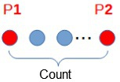

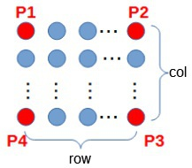

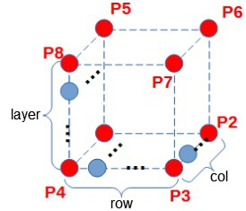

<!-- 中文 PDF 第 40 页 -->

```text
ErrorID,{},CreateTray(  ...  );
```

示例：

```text
  -- 创建名称为t1的5个点的一维托盘。
  CreateTray(t1,  {5},  {pose  =  {x1,y1,z1,rx1,ry1,rz1},pose  =  {x2,y2,z2,rx2,ry2,rz2}})
  -- 创建名称为t2的4x5的二维托盘,下方示例中P1到P4均为pose  =  {x,y,z,rx,ry,rz}格式的点位。
  CreateTray(t2,  {4,5},  {P1,P2,P3,P4})
  -- 创建名称为t3的4x5x6的三维托盘，下方示例中P1到P8均为pose  =  {x,y,z,rx,ry,rz}格式的点位。
  CreateTray(t2,  {4,5,6},  {P1,P2,P3,P4,P5,P6,P7,P8})
```

<a id="cmd-gettraypoint"></a>

### GetTrayPoint

原型：

```text
  GetTrayPoint(Trayname,  index)
```

描述:

获取指定托盘指定序号的点位。点位序号和创建托盘时传入的点位顺序有关。

一维托盘：P1点序号为1，P2点序号与点位数量相同，以此类推。

二维托盘：下图以3x3的托盘为例说明示教点与点位序号的关系。

三维托盘：参考二维托盘，第二层的第一个点的序号为第一层最后一个点的序号加一，以此类
    推。

必选参数：

```text
     参数名             类型         说明
```

**原文插图（第 40 页）**

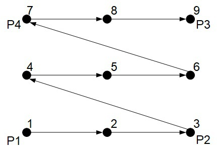

<!-- 中文 PDF 第 41 页 -->

```text
Trayname         string      已创建的托盘名称，最长32字节的字符串。

 index            int         要获取的点位的序号。
```

返回：

```text
 ErrorID,{isErr,x,y,z,rx,ry,rz},GetTrayPoint(trayName,index);
```

isErr表示获取点位的结果，0表示获取成功，-1表示获取失败。

x,y,z,rx,ry,rz为获取到的点位坐标。

示例：

-- 获取名称为t1的托盘的序号为3的点位。
 GetTrayPoint(t1,3)

<!-- 中文 PDF 第 42 页 -->

<a id="manual-24"></a>

## 2.4 IO相关指令

指令列表

| 指令 | 功能 |
| --- | --- |
| `DO` | 设置数字输出端口状态（队列指令） |
| `DOInstant` | 设置数字输出端口状态（立即指令） |
| `GetDO` | 获取数字输出端口状态 |
| `DOGroup` | 设置多个数字输出端口状态（队列指令） |
| `GetDOGroup` | 获取多个数字输出端口状态 |
| `ToolDO` | 设置末端数字输出端口状态（队列指令） |
| `ToolDOInstant` | 设置末端数字输出端口状态（立即指令） |
| `GetToolDO` | 获取末端数字输出端口状态 |
| `AO` | 设置模拟输出端口的值（队列指令） |
| `AOInstant` | 设置模拟输出端口的值（立即指令） |
| `GetAO` | 获取模拟输出端口的值 |
| `DI` | 获取DI端口的状态 |
| `DIGroup` | 获取多个DI端口的状态 |
| `ToolDI` | 获取末端DI端口的状态 |
| `AI` | 获取AI端口的值 |
| `ToolAI` | 获取末端AI端口的值 |
| `SetTool485` | 设置末端485通信格式 |
| `SetToolPower` | 设置末端工具供电状态 |
| `SetToolMode` | 设置末端复用端子的模式 |


队列指令与立即指令

队列指令：系统会等待之前的指令队列执行完毕后再执行这条指令。例如，DO指令之前是一
  串运动指令，系统会等待机械臂运动完毕后再设置DO。

立即指令：系统会无视指令队列，在读到这条指令后立刻执行。例如，DOInstant指令之前是
  一串运动指令，系统不会等待机械臂运动完毕，而是在读到这条指令后立刻设置DO。

<!-- 中文 PDF 第 43 页 -->

如无特殊说明，读取输入的指令都是立即指令。

<a id="cmd-do"></a>

### DO

**原型**

```text
 DO(index,status,time)
```

**描述**

设置数字输出端口状态（队列指令）。

**必选参数**

```text
    参数名         类型       说明

 index        int        DO端子的编号

 status       int        DO端子的状态，1：ON；0：OFF
```

**可选参数**

```text
 参数     类    说明
  名     型

             持续输出时间，取值范围：[25, 60000]。单位：ms
 time   int  如果设置了该参数，系统会在指定时间后对DO自动取反。取反为异步动作，
             不会阻塞指令队列，系统执行了DO输出后就会执行下一条指令。
```

**返回**

```text
 ErrorID,{ResultID},DO(index,status,time);
```

ResultID为算法队列ID，可用于判断指令执行顺序。

**示例**

```text
 DO(1,1,2000)
```

设置DO_1为ON，2秒后自动取反。

<a id="cmd-doinstant"></a>

### DOInstant

**原型**

```text
 DOInstant(index,status)
```

<!-- 中文 PDF 第 44 页 -->

**描述**

设置数字输出端口状态（立即指令）。

**必选参数**

```text
    参数名           类型       说明

 index          int        DO端子的编号

 status         int        DO端子的状态，1：ON；0：OFF
```

**返回**

```text
 ErrorID,{},DOInstant(index,status);
```

**示例**

```text
 DOInstant(1,1)
```

无视指令队列，立即设置DO_1为ON。

<a id="cmd-getdo"></a>

### GetDO

**原型**

```text
 GetDO(index)
```

**描述**

获取数字输出端口状态。

**必选参数**

```text
        参数名                 类型          说明

 index                 int              DO端子的编号
```

**返回**

```text
 ErrorID,{value},GetDO(index);
```

value表示DO端子的状态，0为OFF，1为ON。

**示例**

```text
 GetDO(1)
```

<!-- 中文 PDF 第 45 页 -->

获取DO_1的状态。

<a id="cmd-dogroup"></a>

### DOGroup

**原型**

```text
 DOGroup(index1,value1,index2,value2,...,indexN,valueN)
```

**描述**

设置多个数字输出端口状态（队列指令）。

**必选参数**

```text
    参数名           类型        说明

 index1          int        第一个DO端子的编号

 value1          int        第一个DO端子的状态，1：ON；0：OFF

 ...             ...        ...

 indexN          int        第N个DO端子的编号

 valueN          int        第N个DO端子的状态，1：ON；0：OFF
```

**返回**

```text
 ErrorID,{ResultID},DOGroup(index1,value1,index2,value2,...,indexN,valueN);
```

ResultID为算法队列ID，可用于判断指令执行顺序。

**示例**

```text
 DOGroup(4,1,6,0,2,1,7,0)
```

设置DO_4为ON，DO_6为OFF，DO_2为ON，DO_7为OFF。

<a id="cmd-getdogroup"></a>

### GetDOGroup

**原型**

```text
 GetDOGroup(index1,index2,...,indexN)
```

**描述**

<!-- 中文 PDF 第 46 页 -->

获取多个数字输出端口状态。

**必选参数**

```text
       参数名                类型          说明

 index                int             第一个DO端子的编号

 ...                  ...             ...

 indexN               int             第N个DO端子的编号
```

**返回**

```text
 ErrorID,{value1,value2,...,valueN},GetDOGroup(index1,index2,...,indexN);
```

{value1,value2,...,valueN}分别表示DO_1到DO_N的状态，0为OFF，1为ON

**示例**

```text
 GetDOGroup(1,2)
```

获取DO_1和DO_2的状态。

<a id="cmd-tooldo"></a>

### ToolDO

**原型**

```text
 ToolDO(index,status)
```

**描述**

设置末端数字输出端口状态（队列指令）。

**必选参数**

```text
    参数名           类型       说明

 index          int        末端DO端子的编号

 status         int        末端DO端子的状态，1：ON；0：OFF
```

**返回**

```text
 ErrorID,{ResultID},ToolDO(index,status);
```

ResultID为算法队列ID，可用于判断指令执行顺序。

<!-- 中文 PDF 第 47 页 -->

**示例**

```text
 ToolDO(1,1)
```

设置末端DO_1为ON。

<a id="cmd-tooldoinstant"></a>

### ToolDOInstant

**原型**

```text
 ToolDOInstant(index,status)
```

**描述**

设置末端数字输出端口状态（立即指令）。

**必选参数**

```text
    参数名          类型      说明

 index         int       末端DO端子的编号

 status        int       末端DO端子的状态，1：ON；0：OFF
```

**返回**

```text
 ErrorID,{},ToolDOInstant(index,status);
```

**示例**

```text
 ToolDOInstant(1,1)
```

无视指令队列，立即设置末端DO_1为ON。

<a id="cmd-gettooldo"></a>

### GetToolDO

**原型**

```text
 GetToolDO(index)
```

**描述**

获取末端数字输出端口状态。

**必选参数**

<!-- 中文 PDF 第 48 页 -->

```text
参数名               类型         说明

 index               int            末端DO端子的编号
```

**返回**

```text
 ErrorID,{value},GetToolDO(index);
```

value表示末端DO端子的状态，0为OFF，1为ON。

**示例**

```text
 GetToolDO(1)
```

获取末端DO_1的状态。

<a id="cmd-ao"></a>

### AO

**原型**

```text
 AO(index,value)
```

**描述**

设置模拟输出端口的值（队列指令）。

**必选参数**

```text
  参数       类型      说明
   名

 index   int       AO端子的编号

 value   double    AO端子的输出值，电压取值范围：[0,10]，单位：V；电流取值范围：
                   [4,20]，单位：mA
```

**返回**

```text
 ErrorID,{ResultID},AO(index,value);
```

ResultID为算法队列ID，可用于判断指令执行顺序。

**示例**

```text
 AO(1,2)
```

<!-- 中文 PDF 第 49 页 -->

设置AO_1的值为2。

<a id="cmd-aoinstant"></a>

### AOInstant

**原型**

```text
 AOInstant(index,value)
```

**描述**

设置模拟输出端口的值（立即指令）。

**必选参数**

```text
  参数      类型      说明
   名

 index   int      AO端子的编号

 value   double   AO端子的输出值，电压取值范围：[0,10]，单位：V；电流取值范围：
                  [4,20]，单位：mA
```

**返回**

```text
 ErrorID,{},AOInstant(index,value);
```

**示例**

```text
 AOInstant(1,2)
```

无视指令队列，立即设置AO_1的值为2。

<a id="cmd-getao"></a>

### GetAO

**原型**

```text
 GetAO(index)
```

**描述**

获取模拟量输出端口的值。

**必选参数**

```text
       参数名                 类型          说明

 index                int              AO端子的编号
```

<!-- 中文 PDF 第 50 页 -->

**返回**

```text
 ErrorID,{value},GetAO(index);
```

value表示AO端子的值。

**示例**

```text
 GetAO(1)
```

获取AO_1的值。

<a id="cmd-di"></a>

### DI

**原型**

```text
 DI(index)
```

**描述**

获取DI端口的状态。

**必选参数**

```text
        参数名                   类型           说明

 index                   int               DI端子的编号
```

**返回**

```text
 ErrorID,{value},DI(index);
```

value表示DI端子的状态，0为OFF，1为ON

**示例**

```text
 DI(1)
```

获取DI_1的状态。

<a id="cmd-digroup"></a>

### DIGroup

**原型**

<!-- 中文 PDF 第 51 页 -->

```text
DIGroup(index1,index2,...,indexN)
```

**描述**

获取多个DI端口的状态。

**必选参数**

```text
        参数名                  类型           说明

  index1                 int              第一个DI端子的编号

  ...                    ...              ...

  indexN                 int              第N个DI端子的编号
```

**返回**

```text
  ErrorID,{value1,value2,...,valueN},DIGroup(index1,index2,...,indexN);
```

{value1,value2,...,valueN}分别表示DI_1到DI_N的状态，0为OFF，1为ON

**示例**

```text
  DIGroup(4,6,2,7)
```

获取DI_4，DI_6，DI_2，DI_7的状态。

<a id="cmd-tooldi"></a>

### ToolDI

**原型**

```text
  ToolDI(index)
```

**描述**

获取末端DI端口的状态。

**必选参数**

```text
        参数名                   类型           说明

  index                  int               末端DI端子的编号
```

**返回**

```text
  ErrorID,{value},ToolDI(index);
```

<!-- 中文 PDF 第 52 页 -->

value表示末端DI端子的状态，0为OFF，1为ON

**示例**

```text
 ToolDI(1)
```

获取末端DI_1的状态。

<a id="cmd-ai"></a>

### AI

**原型**

```text
 AI(index)
```

**描述**

获取AI端口的值。

**必选参数**

```text
        参数名                  类型           说明

 index                  int               AI端子的编号
```

**返回**

```text
 ErrorID,{value},AI(index);
```

value表示AI端子的输入值

**示例**

```text
 AI(1)
```

获取AI_1的输入值。

<a id="cmd-toolai"></a>

### ToolAI

**原型**

```text
 ToolAI(index)
```

**描述**

<!-- 中文 PDF 第 53 页 -->

获取末端AI端口的值。使用前需要通过SetToolMode将端子设置为模拟输入模式。

**必选参数**

```text
      参数名               类型        说明

 index              int           末端AI端子的编号
```

**返回**

```text
 ErrorID,{value},ToolAI(index);
```

value表示末端AI端子的输入值

**示例**

```text
 ToolAI(1)
```

获取末端AI_1的输入值。

<a id="cmd-settool485"></a>

### SetTool485

原型：

```text
 SetTool485(baud,parity,stopbit,identify)
```

描述:

设置末端工具的RS485接口对应的数据格式。

**必选参数**

```text
      参数名              类型        说明

 baud              int           RS485接口的波特率
```

**可选参数**

```text
  参数名      类型     说明

 parity   string  是否有奇偶校验位。"O"表示奇校验，"E"表示偶校验，"N"表示无奇
                  偶校验位。默认值为“N”。

 stopbit  int     停止位长度。取值范围：1，2。默认值为1。

 identify int     当机械臂为多航插机型时，用于指定设置的航插。1：航插1；2：航
                  插2
```

<!-- 中文 PDF 第 54 页 -->

**返回**

```text
 ErrorID,{},SetTool485(baud,parity,stopbit);
```

示例：

```text
 SetTool485(115200,"N",1)
```

将末端工具的RS485接口对应的波特率设置为115200Hz，无奇偶校验位，停止位长度为1。

<a id="cmd-settoolpower"></a>

### SetToolPower

原型：

```text
 SetToolPower(status,identify)
```

描述:

设置末端工具供电状态，一般用于重启末端电源，例如对末端夹爪重新上电初始化。如需连续调用
该接口，建议至少间隔4ms以上。

说明：
 Magician E6机器人不支持该指令，调用无效果。

**必选参数**

```text
   参数名        类型     说明

 status      int     末端工具供电状态，0：关闭电源；1：打开电源
```

**可选参数**

```text
  参数名      类型     说明

 identify  int    当机械臂为多航插机型时，用于指定设置的航插。1：航插1；2：航插2
```

**返回**

```text
 ErrorID,{},SetToolPower(status);
```

示例：

```text
 SetToolPower(0)
```

**原文插图（第 54 页）**


<!-- 中文 PDF 第 55 页 -->

关闭末端电源。

<a id="cmd-settoolmode"></a>

### SetToolMode

原型：

```text
 SetToolMode(mode,type,identify)
```

描述:

机械臂末端AI接口与485接口复用端子时，可通过此接口设置末端复用端子的模式。默认模式为
485模式。

说明：
 不支持末端模式切换的机械臂调用此接口无效果。

**必选参数**

```text
  参数    类    说明
  名     型

 mode   int  复用端子的模式，1：485模式，2：模拟输入模式

 type   int  当mode为1时，该该参数无效。当mode为2时，可设置模拟输入的模式。
             个位表示AI1的模式，十位表示AI2的模式，十位为0时可仅输入个位。
```

模式：
     0：0~10V电压输入模式
     1：电流采集模式
     2：0~5V电压输入模式
  例子：
     0：AI1与AI2均为0~10V电压输入模式
     1：AI2是0~10V电压输入模式，AI1是电流采集模式
     11：AI2和AI1都是电流采集模式
     12：AI2是电流采集模式，AI1是0~5V电压输入模式
     20：AI2是0~5V电压输入模式，AI1是0~10V电压输入模式
可选参数

```text
 参数名     类型    说明

 identifyint   当机械臂为多航插机型时，用于指定设置的航插。1：航插1；2：航插2
```

**返回**

**原文插图（第 55 页）**


<!-- 中文 PDF 第 56 页 -->

```text
ErrorID,{},SetToolMode(mode,type);
```

示例：

```text
 SetToolMode(2,0)
```

设置末端复用端子为模拟输入，两路都是0~10V电压输入模式。

<!-- 中文 PDF 第 57 页 -->

<a id="manual-25"></a>

## 2.5 Modbus相关指令

指令列表

| 指令 | 功能 |
| --- | --- |
| `ModbusCreate` | 创建Modbus主站 |
| `ModbusRTUCreate` | 创建基于RS485接口的Modbus主站 |
| `ModbusClose` | 和Modbus从站断开连接 |
| `GetInBits` | 读取触点寄存器 |
| `GetInRegs` | 读取输入寄存器 |
| `GetCoils` | 读取线圈寄存器 |
| `SetCoils` | 写入线圈寄存器 |
| `GetHoldRegs` | 读取保持寄存器 |
| `SetHoldRegs` | 写入保存寄存器 |


Modbus函数用于建立Modbus主站与从站进行通讯，寄存器地址的取值范围与定义请参考对应从
站的Modbus寄存器地址定义说明。

各类寄存器对应的Modbus功能码遵循标准Modbus协议：

```text
   寄存器类型           读取寄存器           写单个寄存器            写多个寄存器

 线圈寄存器           01             05                0F

 触点寄存器           02             -                 -

 输入寄存器           04             -                 -

 保持寄存器           03             06                10
```

<a id="cmd-modbuscreate"></a>

### ModbusCreate

**原型**

```text
 ModbusCreate(ip,port,slave_id,isRTU)
```

**描述**

创建Modbus主站，并和从站建立连接。最多支持同时连接5个设备。

<!-- 中文 PDF 第 58 页 -->

**必选参数**

```text
         参数名                    类型           说明

 ip                      string              从站IP地址

 port                    int                 从站端口

 slave_id                int                 从站ID
```

**可选参数**

```text
  参数      类     说明
   名      型

 isRTU   int    如果不携带或为0，建立modbusTCP通信； 如果为1，建立modbusRTU
                通信
```

注意：
 此参数决定了连接建立后传输数据使用的协议格式，并不影响连接结果。因此，如果创建主
 站时该参数设置错误，依然可以创建成功，但后续通讯时会导致异常。

**返回**

```text
 ErrorID,{index},ModbusCreate(ip,port,slave_id,isRTU);

   ErrorID为0表示创建成功，-1表示创建失败，其余错误码请参考通用错误码
   index为返回的主站索引，后续调用其他Modbus指令时使用
示例

 ModbusCreate("127.0.0.1",60000,1,0)
```

建立modbusTCP通信主站，连接本机的Modbus从站，端口为60000，从站ID为1。

<a id="cmd-modbusrtucreate"></a>

### ModbusRTUCreate

原型：

```text
 ModbusRTUCreate(slave_id,  baud,  parity,  data_bit,  stop_bit)
```

描述:

创建基于RS485接口的Modbus主站，并和从站建立连接。最多支持同时连接5个设备。

**必选参数**

**原文插图（第 58 页）**


<!-- 中文 PDF 第 59 页 -->

```text
参数名               类型        说明

 slave_id            int           从站ID

 baud                int           RS485接口的波特率。
```

**可选参数**

```text
  参数名       类型      说明

 parity     string  是否有奇偶校验位。"O"表示奇校验，"E"表示偶校验，"N"表示无奇
                    偶校验位。默认值为“E”。

 data_bit   int     数据位长度。取值范围：8。默认值为8。

 stop_bit   int     停止位长度。取值范围：1，2。默认值为1。
```

返回：

```text
 ErrorID,{index},ModbusRTUCreate(slave_id,  baud,  parity,  data_bit,  stop_bit)

   ErrorID为0表示创建成功，-1表示创建失败，其余错误码请参考通用错误码
   index为返回的主站索引，后续调用其他Modbus指令时使用
示例：

 ModbusRTUCreate(1, 115200)
```

创建Modbus主站并与RS485接口连接的从站建立连接，从站ID为1，波特率为115200。

<a id="cmd-modbusclose"></a>

### ModbusClose

**原型**

```text
 ModbusClose(index)
```

**描述**

和Modbus从站断开连接，释放主站。

**必选参数**

```text
     参数名             类型        说明

 index            int          创建主站时返回的主站索引
```

**返回**

```text
 ErrorID,{},ModbusClose(index);
```

<!-- 中文 PDF 第 60 页 -->

**示例**

```text
 ModbusClose(0)
```

释放索引为0的Modbus主站。

<a id="cmd-getinbits"></a>

### GetInBits

**原型**

```text
 GetInBits(index,addr,count)
```

**描述**

读取Modbus从站触点寄存器（离散输入）地址的值。

**必选参数**

```text
   参数名        类型       说明

 index       int       创建主站时返回的主站索引

 addr        int       触点寄存器起始地址

 count       int       连续读取触点寄存器的值的数量。取值范围：[1, 16]
```

**返回**

```text
 ErrorID,{value1,value2,...,valuen},GetInBits(index,addr,count);
```

{value1,value2,...,valuen}为读取的值，数量与count相同。

**示例**

```text
 GetInBits(0,3000,5)
```

从地址为3000的触点寄存器开始读取5个值。

<a id="cmd-getinregs"></a>

### GetInRegs

**原型**

```text
 GetInRegs(index,addr,count,valType)
```

<!-- 中文 PDF 第 61 页 -->

**描述**

按照指定的数据类型，读取Modbus从站输入寄存器地址的值。

**必选参数**

```text
  参数名        类型     说明

 index      int     创建主站时返回的主站索引

 addr       int     输入寄存器起始地址

 count      int     连续读取输入寄存器的值的数量。取值范围：[1, 4]
```

**可选参数**

```text
   参数名        类型      说明

                      读取的数据类型：
                      U16：16位无符号整数（2个字节，占用1个寄存器）；
 valType    string    U32：32位无符号整数（4个字节，占用2个寄存器）
                      F32：32位单精度浮点数（4个字节，占用2个寄存器）
                      F64：64位双精度浮点数（8个字节，占用4个寄存器）
                      默认为U16
```

**返回**

```text
 ErrorID,{value1,value2,...,valuen},GetInRegs(index,addr,count,valType);
```

{value1,value2,...,valuen}为读取的值，数量与count相同。

**示例**

```text
 GetInRegs(0,4000,3)
```

从地址为4000的输入寄存器开始读取3个值，值类型为U16。

<a id="cmd-getcoils"></a>

### GetCoils

**原型**

```text
 GetCoils(index,addr,count)
```

**描述**

读取Modbus从站线圈寄存器地址的值。

**必选参数**

<!-- 中文 PDF 第 62 页 -->

```text
参数名        类型      说明

 index       int      创建主站时返回的主站索引

 addr        int      线圈寄存器起始地址

 count       int      连续读取线圈寄存器的值的数量。取值范围：[1, 16]
```

**返回**

```text
 ErrorID,{value1,value2,...,valuen},GetCoils(index,addr,count);
```

{value1,value2,...,valuen}为读取的值，数量与count相同。

**示例**

```text
 GetCoils(0,1000,3)
```

从地址为1000的线圈寄存器开始读取3个值。

<a id="cmd-setcoils"></a>

### SetCoils

**原型**

```text
 SetCoils(index,addr,count,valTab)
```

**描述**

将指定的值写入线圈寄存器指定的地址。

**必选参数**

```text
   参数名         类型       说明

 index       int        创建主站时返回的主站索引

 addr        int        线圈寄存器起始地址

 count       int        连续写入线圈寄存器的值的数量。取值范围：[1, 16]

 valTab      string     要写入的值，数量与count相同
```

**返回**

```text
 ErrorID,{},SetCoils(index,addr,count,valTab);
```

**示例**

<!-- 中文 PDF 第 63 页 -->

```text
SetCoils(0,1000,3,{1,0,1})
```

从地址为1000的线圈寄存器开始连续写入3个值，分别为1，0，1。

<a id="cmd-getholdregs"></a>

### GetHoldRegs

**原型**

```text
 GetHoldRegs(index,addr,  count,valType)
```

**描述**

按照指定的数据类型，读取Modbus从站保持寄存器地址的值。

**必选参数**

```text
  参数名        类型      说明

 index      int      创建主站时返回的主站索引

 addr       int      保持寄存器起始地址

 count      int      连续读取保持寄存器的值的数量。取值范围：[1, 4]
```

**可选参数**

```text
   参数名        类型      说明

                      读取的数据类型：
                      U16：16位无符号整数（2个字节，占用1个寄存器）；
 valType     string   U32：32位无符号整数（4个字节，占用2个寄存器）
                      F32：32位单精度浮点数（4个字节，占用2个寄存器）
                      F64：64位双精度浮点数（8个字节，占用4个寄存器）
                      默认为U16
```

**返回**

```text
 ErrorID,{value1,value2,...,valuen},GetHoldRegs(index,addr,  count,valType);
```

{value1,value2,...,valuen}为读取的值，数量与count相同。

**示例**

```text
 GetHoldRegs(0,3095,1)
```

从地址为3095的保持寄存器开始读取1个值，值类型为U16。

<!-- 中文 PDF 第 64 页 -->

<a id="cmd-setholdregs"></a>

### SetHoldRegs

**原型**

```text
 SetHoldRegs(index,addr,  count,valTab,valType)
```

**描述**

将指定的值以指定的数据类型写入Modbus从站保持寄存器指定的地址。

**必选参数**

```text
  参数名         类型      说明

 index      int       创建主站时返回的主站索引

 addr       int       保持寄存器起始地址

 count      int       连续写入保持寄存器的值的数量。取值范围：[1, 4]

 valTab     string    要写入的值，数量与count相同。
```

**可选参数**

```text
   参数名        类型      说明

                      写入的数据类型：
                      U16：16位无符号整数（2个字节，占用1个寄存器）；
 valType     string   U32：32位无符号整数（4个字节，占用2个寄存器）
                      F32：32位单精度浮点数（4个字节，占用2个寄存器）
                      F64：64位双精度浮点数（8个字节，占用4个寄存器）
                      默认为U16
```

**返回**

```text
 ErrorID,{},SetHoldRegs(index,addr,  count,valTab,valType);
```

**示例**

```text
 SetHoldRegs(0,3095,2,{6000,300},  U16)
```

从地址为3095的保持寄存器开始写入两个U16类型的值，分别为6000和300。

<!-- 中文 PDF 第 65 页 -->

<a id="manual-26"></a>

## 2.6 总线寄存器相关指令

指令列表

总线寄存器指令用于读写Profinet或Ethernet/IP总线寄存器。

| 指令 | 功能 |
| --- | --- |
| `GetInputBool` | 获取输⼊寄存器指定地址的bool值 |
| `GetInputInt` | 获取输⼊寄存器指定地址的int值 |
| `GetInputFloat` | 获取输⼊寄存器指定地址的float值 |
| `GetOutputBool` | 获取输出寄存器指定地址的bool值 |
| `GetOutputInt` | 获取输出寄存器指定地址的int值 |
| `GetOutputFloat` | 获取输出寄存器指定地址的float值 |
| `SetOutputBool` | 设置输出寄存器指定地址的bool值 |
| `SetOutputInt` | 设置输出寄存器指定地址的int值 |
| `SetOutputFloat` | 设置输出寄存器指定地址的float值 |


<a id="cmd-getinputbool"></a>

### GetInputBool

原型：

```text
 GetInputBool(address)
```

描述:

获取输⼊寄存器指定地址的bool类型的数值。

**必选参数**

```text
     参数名            类型       说明

 address          int        寄存器地址，取值范围[0-63]
```

**返回**

```text
 ErrorID,{value},GetInputBool(address);
```

value表示指定的寄存器地址的值，为0或1

<!-- 中文 PDF 第 66 页 -->

示例：

```text
 GetInputBool(0)
```

读取输入寄存器0的布尔值。

<a id="cmd-getinputint"></a>

### GetInputInt

原型：

```text
 GetInputInt(address)
```

描述:

获取输⼊寄存器指定地址的int类型的数值。

**必选参数**

```text
      参数名             类型       说明

 address           int         寄存器地址，取值范围[0-23]
```

**返回**

```text
 ErrorID,{value},GetInputInt(address);
```

value表示指定的寄存器地址的值，为整型数（int32）

示例：

```text
 GetInputInt(1)
```

读取输入寄存器1的int值。

<a id="cmd-getinputfloat"></a>

### GetInputFloat

原型：

```text
 GetInputFloat(address)
```

描述:

获取输⼊寄存器指定地址的float类型的数值。

**必选参数**

<!-- 中文 PDF 第 67 页 -->

```text
参数名             类型        说明

 address           int          寄存器地址，取值范围[0-23]
```

**返回**

```text
 ErrorID,{value},GetInputInt(address);
```

value表示指定的寄存器地址的值，为单精度浮点数（float）

示例：

```text
 GetInputFloat(2)
```

读取输入寄存器2的float值。

<a id="cmd-getoutputbool"></a>

### GetOutputBool

原型：

```text
 GetOutputBool(address)
```

描述:

获取输出寄存器指定地址的bool类型的数值。

**必选参数**

```text
      参数名             类型        说明

 address           int          寄存器地址，取值范围[0-63]
```

**返回**

```text
 ErrorID,{value},GetOutputBool(address);
```

value表示指定的寄存器地址的值，为0或1

示例：

```text
 GetOutputBool(0)
```

获取输出寄存器0的布尔值。

<a id="cmd-getoutputint"></a>

### GetOutputInt

<!-- 中文 PDF 第 68 页 -->

原型：

```text
 GetOutputInt(address)
```

描述:

获取输出寄存器指定地址的int类型的数值。

**必选参数**

```text
      参数名              类型        说明

 address            int          寄存器地址，取值范围[0-23]
```

**返回**

```text
 ErrorID,{value},GetOutputInt(address);
```

value表示指定的寄存器地址的值，为整型数（int32）

示例：

```text
 local  regInt  =  GetOutputInt(1)
```

读取输出寄存器1的值并赋值给变量regInt。

<a id="cmd-getoutputfloat"></a>

### GetOutputFloat

原型：

```text
 GetOutputFloat(address)
```

描述:

获取输出寄存器指定地址的float类型的数值。

**必选参数**

```text
      参数名              类型        说明

 address            int          寄存器地址，取值范围[0-23]
```

**返回**

```text
 ErrorID,{value},GetOutputFloat(address);
```

<!-- 中文 PDF 第 69 页 -->

value表示指定的寄存器地址的值，为单精度浮点数（float）

示例：

```text
 local  regFloat  =  GetOutputFloat(2)
```

读取输出寄存器2的值并赋值给变量regFloat。

<a id="cmd-setoutputbool"></a>

### SetOutputBool

原型：

```text
 SetOutputBool(address,  value)
```

描述:

设置输出寄存器指定地址的bool类型的数值。

**必选参数**

```text
      参数名              类型        说明

 address            int          寄存器地址，取值范围[0-63]

 value              int          要设置的值，支持0或1
```

**返回**

```text
 ErrorID,{},SetOutputBool(address,  value);
```

示例：

```text
 SetOutputBool(0,0)
```

设置输出寄存器0的值为假。

<a id="cmd-setoutputint"></a>

### SetOutputInt

原型：

```text
 SetOutputInt(address,  value)
```

描述:

设置输出寄存器指定地址的int类型的数值。

<!-- 中文 PDF 第 70 页 -->

**必选参数**

```text
      参数名              类型         说明

 address             int          寄存器地址，取值范围[0-23]

 value               int          要设置的值，支持整型数
```

**返回**

```text
 ErrorID,{},SetOutputInt(address,  value);
```

示例：

```text
 SetOutputInt(1,123)
```

设置输出寄存器1的值为123。

<a id="cmd-setoutputfloat"></a>

### SetOutputFloat

原型：

```text
 SetOutputFloat(address,  value)
```

描述:

设置输出寄存器指定地址的float类型的数值。

**必选参数**

```text
      参数名             类型         说明

 address            int          寄存器地址，取值范围[0-23]

 value              float        要设置的值，支持单精度浮点数
```

**返回**

```text
 ErrorID,{},SetOutputFloat(address,  value);
```

示例：

```text
 SetOutputFloat(2,12.3)
```

设置输出寄存器2的值为12.3。

<!-- 中文 PDF 第 71 页 -->

<a id="manual-27"></a>

## 2.7 运动相关指令

**参数格式**

运动指令中点位参数和可选参数均为string类型，格式为“key=value”，例如“joint = {10, 10,
10, 0, 0, 0}”，“user=1”。为方便用户理解参数，下文参数表中此类参数的类型列均表示value
的类型。

**运动方式**

机械臂支持的运动方式可分为下述几类。

关节运动

机械臂根据当前各关节角度和目标点各关节角度的差值规划各个关节的运动，使各个关节关节同时
完成运动。关节运动不约束TCP（Tool Center Point）的运动轨迹，一般情况下该轨迹非直线。

关节运动不受奇异位置限制（奇异点位置详见机械臂对应的硬件手册），因此如果对运动轨迹没有
要求，或目标点位在奇异位置附近，建议使用关节运动。

直线运动

机械臂根据当前位姿和目标点的位姿规划运动轨迹，使TCP运动轨迹为直线，且末端姿态在运动过
程中匀速变化。

当运动轨迹会经过奇异位置时，下发直线运动指令给继机械臂会产生报错，建议重新规划点位或在
奇异位置附近采用关节运动。

弧线运动

机械臂通过当前位置，P1，P2三个不共线的点确定一个圆弧或整圆。运动过程中的机械臂末端姿
态通过当前点和P2点的姿态插补算出，P1点的姿态不参与运算（即运动过程中机械臂到达P1点时
的姿态可能与示教姿态不同）。

**原文插图（第 71 页）**


<!-- 中文 PDF 第 72 页 -->

当运动轨迹会经过奇异位置时，下发弧线运动指令给继机械臂会产生报错，建议重新规划点位或在
奇异位置附近采用关节运动。

**点位参数**

如无特殊说明，运动指令中所有点位参数（P）都支持两种表达方式：

关节变量：使用各个机械臂各个关节的角度（j1~j6）表示目标点位。作为目标点时会通过正
  解变换为位姿变量再使用。

```text
 joint  =  {j1,  j2,  j3,  j4,  j5,  j6}
```

位姿变量：使用笛卡尔坐标（x，y，z）表示目标点位在用户坐标系中的空间位置，使用欧拉
  角（rx，ry，rz）表示TCP（Tool Center Point）到达该点时工具坐标系相对于用户坐标系的
  旋转角度。

越疆机械臂计算欧拉角时的旋转顺序为X->Y->Z，每个轴都是绕固定轴（用户坐标系）旋
  转，如下图所示（rx=γ，ry=β，rz=α）。

确定了旋转顺序后，就可以将旋转矩阵（其中cα为cosα，sα为sinα的简写，以此类推）

**原文插图（第 72 页）**

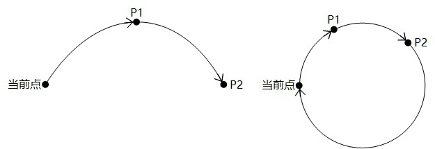

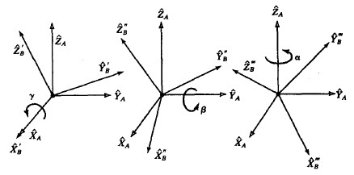

<!-- 中文 PDF 第 73 页 -->

推导为方程

通过该方程计算机械臂末端的姿态。

```text
 pose  =  {x,  y,  z,  rx,  ry,  rz}
```

**坐标系参数**

笛卡尔坐标系相关的运动指令，可选参数的user和tool用于指定目标点的用户和工具坐标系：

当前仅支持通过索引序号指定，需要先在控制软件中添加对应坐标系。

如果不携带user和tool参数，则使用全局用户和工具坐标系，详见设置相关指令中的User和Tool
指令说明（未调用指令设置时的默认坐标系均为0）。

**运动参数**

**相对速率**

可选参数中的a和v用于指定机械臂执行该运动指令时的加速度和速度比例。

```text
 机械臂实际运动速度  = 最大速度  x 全局速率  x 指令速率
 机械臂实际运动加速度  = 最大加速度  x 指令速率
```

其中最大速度/加速度受再现设置控制，可在控制软件的运动参数页面查看与修改；

**原文插图（第 73 页）**

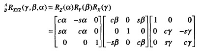

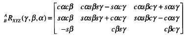

<!-- 中文 PDF 第 74 页 -->

全局速率可通过控制软件（上图右上角）或SpeedFactor指令设置；

指令速率为运动指令可选参数携带的比例，未通过可选参数指定运动加速度/速度比例时，默认使
用运动参数中设置的值（详见VelJ，AccJ，VelL，AccL指令，未调用指令设置时的默认值均为
100）。

例：

```text
 AccJ(50) -- 设置关节运动默认加速度为50%
 VelJ(60) -- 设置关节运动默认速度为60%
 AccL(70) -- 设置直线运动默认加速度为70%
 VelL(80) -- 设置直线运动默认速度为80%
```

-- 全局速率为20%；

```text
 MovJ(P1) -- 以（关节加速度最大值  x  50%）的加速度和（关节速度最大值  x  20%  x  60%）的速度关节运动至P1
 MovJ(P2,{a  = 30,  v  = 80}) -- 以（关节加速度最大值  x  30%）的加速度和（关节速度最大值  x  20%  x  80%）关
 节运动至P1

 MovL(P1) -- 以（笛卡尔加速度最大值  x  70%）的加速度和直线速度（笛卡尔速度最大值  x  20%  x  80%）的速度运
 动至P1
 MovL(P1,{a  = 40,  v  = 90})   -- 以（笛卡尔加速度最大值  x  40%）的加速度和（笛卡尔速度最大值  x  20%  x  90
 %）的速度直线运动至P1
```

**绝对速度**

直线和弧线运动指令可选参数中的speed用于指定械臂执行该运动指令时的绝对速度。

绝对速度不受全局速率影响，但受再现设置中的最大速度限制（如果机械臂进入了缩减模式，则受
缩减后的最大速度限制），即speed参数设置的目标速度如果大于再现设置中的最大速度，则以最
大速度为准。

例：

```text
 MovL(P1,{speed  = 1000})   -- 以1000的绝对速率直线移动至P1
```

**原文插图（第 74 页）**

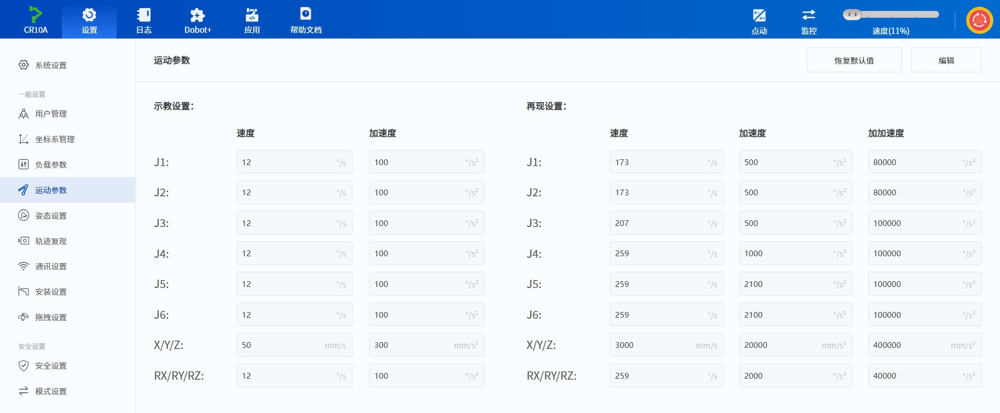

<!-- 中文 PDF 第 75 页 -->

MovL设置了speed为1000，小于再现设置最大速度的2000，则机械臂会以1000mm/s为目标速
度进行运动，该目标速度与此时的全局速率无关。但如果机械臂处于缩减模式（假设缩减率为
10%），则最大速度变为200，小于1000，此时机械臂会以200mm/s为目标速度进行运动。

speed参数和v参数互斥，若同时存在以speed为准。

平滑过渡参数

机械臂连续运动经过多个点时，可以通过平滑过渡的方式经过中间点，避免机械臂拐弯过于生硬。
如果用户指定的几个路径点基于不同的工具坐标系，则无法平滑过渡。

可选参数中的cp或r用于指定当前运动指令到下一条运动指令之间的平滑过渡比例（cp）或者平滑
过渡半径（r），两者互斥，若同时存在以r为准。

说明：
 关节运动相关命令不支持设置平滑过渡半径（r），详见各指令的可选参数。

设置平滑过渡比例时，系统会自动计算过渡曲线的弧度，CP值越大曲线越平滑，如下图所示。CP
过渡曲线会受运动速度/加速度影响，即使点位和CP值都相同，运动速度/加速度不同时的过渡曲
线弧度也会不同。

设置平滑过渡半径时，系统会以过渡点为圆心，根据指定半径计算过渡曲线。R过渡曲线不受运动
速度/加速度影响，只由点位和过渡半径决定。

**原文插图（第 75 页）**


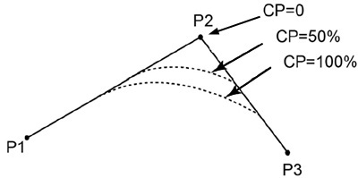

<!-- 中文 PDF 第 76 页 -->

如果用户设置的过渡半径过大（超过起始点/终点与过渡点之间的距离），则系统会自动使用起始
点/终点与过渡点之间较短距离的一半作为过渡半径计算过渡曲线。

未通过可选参数指定平缓过渡比例或半径时，默认使用运动参数中设置的平滑过渡比例（详见CP
指令，未调用指令设置时的默认值为0）。

说明：
 平滑过渡会导致机械臂运动不经过中间点，因此设置了平滑过渡时，两条运动指令之间IO信
 号输出或功能设置（例如开关安全皮肤）指令会在过渡过程中执行。
 如果希望能够在机械臂准确抵达中间点时执行指令，请将前一条指令的平滑过渡参数设置为
 0。

指令列表

| 指令 | 功能 |
| --- | --- |
| `MovJ` | 关节运动 |


**原文插图（第 76 页）**

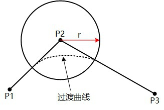

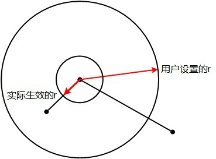


<!-- 中文 PDF 第 77 页 -->

```text
MovL                          直线运动

 MovLIO                        直线运动并输出DO

 MovJIO                        关节运动并输出DO

 Arc                           圆弧插补运动

 Circle                        整圆插补运动

 ServoJ                        基于关节空间的动态跟随命令

 ServoP                        基于笛卡尔空间的动态跟随命令

 MoveJog                       点动机械臂

 RunTo                         运动至指定点位

 GetStartPose                  获取指定轨迹的第一个点位

 StartPath                     复现录制的运动轨迹

 RelMovJTool                   沿工具坐标系进行相对关节运动

 RelMovLTool                   沿工具坐标系进行相对直线运动

 RelMovJUser                   沿用户坐标系进行相对关节运动

 RelMovLUser                   沿用户坐标系进行相对直线运动

 RelJointMovJ                  沿关节坐标系进行相对关节运动

 GetCurrentCommandID           获取当前执行指令的算法队列ID
```

<a id="cmd-movj"></a>

### MovJ

**原型**

```text
 MovJ(P,user,tool,a,v,cp)
```

**描述**

从当前位置以关节运动方式运动至目标点。

**必选参数**

```text
   参数名          类型       说明

 P           string      目标点，支持关节变量或位姿变量
```

**可选参数**

```text
  参数名     类型     说明
```

<!-- 中文 PDF 第 78 页 -->

```text
user      int     用户坐标系

 tool      int     工具坐标系

 a         int     执行该条指令时的机械臂运动加速度比例。取值范围：(0,100]

 v         int     执行该条指令时的机械臂运动速度比例。取值范围：(0,100]

 cp        int     平滑过渡比例。取值范围：[0,100]
```

**返回**

```text
 ErrorID,{ResultID},MovJ(P,user,tool,a,v,cp);
```

ResultID为算法队列ID，可用于判断指令执行顺序。

**示例**

```text
 MovJ(pose={-500,100,200,150,0,90},user=1,  tool=0,  a=20,  v=50,  cp=100)
```

机械臂从当前位置以50%速度，20%加速度，100%平滑过渡比例通过关节运动方式运动至笛卡尔
坐标点{-500,100,200,150,0,90}（用户坐标系1，工具坐标系0）。

<a id="cmd-movl"></a>

### MovL

**原型**

```text
 MovL(P,user,tool,a,v,cp|r)
```

**描述**

从当前位置以直线运动方式运动至目标点。

**必选参数**

```text
    参数名           类型        说明

 P             string       目标点，支持关节变量或位姿变量
```

**可选参数**

```text
  参数      类    说明
   名      型

 user     int  用户坐标系

 tool     int  工具坐标系

 a        int  执行该条指令时的机械臂运动加速度比例。取值范围：(0,100]
```

<!-- 中文 PDF 第 79 页 -->

```text
v       int   执行该条指令时的机械臂运动速度比例，与speed互斥。取值范围：
               (0,100]

 speed   int   执行该条指令时的机械臂运动目标速度，与v互斥，若同时存在以speed为
               准。取值范围：[1, 最大运动速度]，单位：mm/s

 cp      int   平滑过渡比例，与r互斥。取值范围：[0,100]

 r       int   平滑过渡半径，与cp互斥，若同时存在以r为准。单位：mm
```

**返回**

```text
 ErrorID,{ResultID},MovL(P,user,tool,a,v,cp|r);
```

ResultID为算法队列ID，可用于判断指令执行顺序。

**示例**

```text
 MovL(pose={-500,100,200,150,0,90},v=60)
```

机械臂从当前位置以60%的速度通过直线运动方式运动至笛卡尔坐标点
{-500,100,200,150,0,90}。

<a id="cmd-movlio"></a>

### MovLIO

**原型**

```text
 MovLIO(P,{Mode,Distance,Index,Status},...,{Mode,Distance,Index,Status},user,tool,a,v,cp|r)
```

**描述**

从当前位置以直线运动方式运动至目标点，运动时并行设置数字输出端口状态。

**必选参数**

```text
    参数名           类型        说明

 P             string       目标点，支持关节变量或位姿变量
```

{Mode,Distance,Index,Status}为并行数字输出参数，用于设置当机械臂运动到指定距离或百分比
时，触发指定DO。可设置多组，参数具体含义如下：

```text
  参数名       类型    说明

 Mode       int   触发模式。0表示距离百分比，1表示距离数值
```

指定距离。
                  Distance为正数时，表示离起点的距离；

<!-- 中文 PDF 第 80 页 -->

```text
Distance   int    Distance为负数时，表示离目标点的距离；
                   Mode为0时，Distance表示和总距离的百分比；取值范围：(0,100]；
                   Mode为1时，Distance表示距离的值。单位：mm

 Index      int    DO端子的编号

 Status     int    要设置的DO状态，0表示无信号，1表示有信号
```

**可选参数**

```text
  参数      类     说明
   名      型

 user     int   用户坐标系

 tool     int   工具坐标系

 a        int   执行该条指令时的机械臂运动加速度比例。取值范围：(0,100]

 v        int   执行该条指令时的机械臂运动速度比例，与speed互斥。取值范围：
                (0,100]

 speed    int   执行该条指令时的机械臂运动目标速度，与v互斥，若同时存在以speed为
                准。取值范围：[1, 最大运动速度]，单位：mm/s

 cp       int   平滑过渡比例，与r互斥。取值范围：[0,100]

 r        int   平滑过渡半径，与cp互斥，若同时存在以r为准。单位：mm
```

**返回**

```text
 ErrorID,{ResultID},MovLIO(P,{Mode,Distance,Index,Status},...,{Mode,Distance,Index,Status},user
 ,tool,a,v,cp|r);
```

ResultID为算法队列ID，可用于判断指令执行顺序。

**示例1**

```text
 MovLIO(pose={-500,100,200,150,0,90},{0,  30,  2,  1})
```

机械臂从当前位置通过直线运动方式运动至笛卡尔坐标点{-500,100,200,150,0,90}，当运动到距
离起点30%的位置时，将DO2设置为开。

**示例2**

```text
 MovLIO(pose={-500,100,200,150,0,90},{1,  -15,  3,  0})
```

**原文插图（第 80 页）**

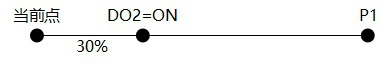

<!-- 中文 PDF 第 81 页 -->

机械臂从当前位置通过直线运动方式运动至笛卡尔坐标点{-500,100,200,150,0,90}，当运动到距
离终点15mm的位置时，将DO3设置为关。

<a id="cmd-movjio"></a>

### MovJIO

**原型**

```text
 MovJIO(P,{Mode,Distance,Index,Status},...,{Mode,Distance,Index,Status},user,tool,a,v,cp)
```

**描述**

从当前位置以关节运动方式运动至目标点，运动时并行设置数字输出端口状态。

**必选参数**

```text
   参数名           类型       说明

 P            string      目标点，支持关节变量或位姿变量
```

{Mode,Distance,Index,Status}为并行数字输出参数，用于设置当机械臂运动到指定距离或百分比
时，触发指定DO。可设置多组，参数具体含义如下：

```text
  参数名      类    说明
           型

 Mode      int  触发模式。0表示距离百分比，1表示距离数值。系统会将各关节角合成
                一个角度向量，并计算终点和起点的角度差作为运动的总距离。

                指定距离。
                Distance为正数时，表示离起点的距离；
 Distance  int  Distance为负数时，表示离目标点的距离；
                Mode为0时，Distance表示和总距离的百分比；取值范围：(0,100]；
                Mode为1时，Distance表示距离的角度。单位：°

 Index     int  DO端子的编号

 Status    int  要设置的DO状态，0表示无信号，1表示有信号
```

**可选参数**

```text
  参数名     类型     说明

 user     int    用户坐标系

 tool     int    工具坐标系

 a        int    执行该条指令时的机械臂运动加速度比例。取值范围：(0,100]
```

**原文插图（第 81 页）**

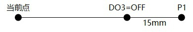

<!-- 中文 PDF 第 82 页 -->

```text
v          int      执行该条指令时的机械臂运动速度比例。取值范围：(0,100]

 cp         int      平滑过渡比例。取值范围：[0,100]
```

**返回**

```text
 ErrorID,{ResultID},MovJIO(P,{Mode,Distance,Index,Status},...,{Mode,Distance,Index,Status},user
 ,tool,a,v,cp);
```

ResultID为算法队列ID，可用于判断指令执行顺序。

**示例1**

```text
 MovJIO(pose={-500,100,200,150,0,90},{0,  30,  2,  1})
```

机械臂从当前位置通过关节运动方式运动至笛卡尔坐标点{-500,100,200,150,0,90}，当运动到距
离起点30%的位置时，将DO2设置为开。

**示例2**

```text
 MovJIO(pose={-500,100,200,150,0,90},{1,  -15,  3,  0})
```

机械臂从当前位置通过关节运动方式运动至笛卡尔坐标点{-500,100,200,150,0,90}，当运动到距
离终点还有15°的位置时，将DO3设置为关。

**原文插图（第 82 页）**

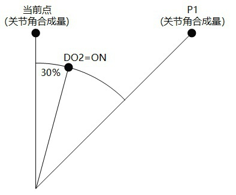

<!-- 中文 PDF 第 83 页 -->

<a id="cmd-arc"></a>

### Arc

**原型**

```text
 Arc(P1,P2,user,tool,a,v,cp|r)
```

**描述**

从当前位置以圆弧插补方式运动至目标点。

需要通过当前位置，圆弧中间点，运动目标点三个点确定一个圆弧，因此当前位置不能在P1和P2
确定的直线上。

**必选参数**

```text
   参数名        类型       说明

 P1         string     圆弧中间点，支持关节变量或位姿变量

 P2         string     运动目标点，支持关节变量或位姿变量
```

**可选参数**

```text
  参数     类   说明
  名      型

 user   int  用户坐标系

 tool   int  工具坐标系

 a      int  执行该条指令时的机械臂运动加速度比例。取值范围：(0,100]
```

**原文插图（第 83 页）**

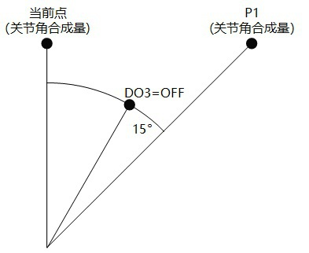

<!-- 中文 PDF 第 84 页 -->

```text
v       int   执行该条指令时的机械臂运动速度比例，与speed互斥。取值范围：
               (0,100]

 speed   int   执行该条指令时的机械臂运动目标速度，与v互斥，若同时存在以speed为
               准。取值范围：[1, 最大运动速度]，单位：mm/s

 cp      int   平滑过渡比例，与r互斥。取值范围：[0,100]

 r       int   平滑过渡半径，与cp互斥，若同时存在以r为准。单位：mm
```

**返回**

```text
 ErrorID,{ResultID},Arc(P1,P2,user,tool,a,v,cp|r);
```

ResultID为算法队列ID，可用于判断指令执行顺序。

**示例**

```text
 Arc(pose={-350,-200,200,150,0,90},pose={-300,-250,200,150,0,90})
```

机械臂从当前位置通过圆弧运动方式经由笛卡尔坐标点{-350,-200,200,150,0,90}运动至笛卡尔坐
标点{-300,-250,200,150,0,90}。

<a id="cmd-circle"></a>

### Circle

**原型**

```text
 Circle(P1,P2,count,user,tool,a,v,cp|r)
```

**描述**

从当前位置进行整圆插补运动，运动指定圈数后重新回到当前位置。

需要通过当前位置，P1，P2三个点确定一个整圆，因此当前位置不能在P1和P2确定的直线上，且
三个点确定的整圆不能超出机械臂的运动范围。

**必选参数**

```text
   参数名         类型       说明

 P1          string     整圆中间点，支持关节变量或位姿变量

 P2          string     整圆结束点点，支持关节变量或位姿变量

 count       int        进行整圆运动的圈数，取值范围：[1,999]。
```

**可选参数**

```text
  参数      类    说明
```

<!-- 中文 PDF 第 85 页 -->

```text
名      型    说明

 user    int   用户坐标系

 tool    int   工具坐标系

 a       int   执行该条指令时的机械臂运动加速度比例。取值范围：(0,100]

 v       int   执行该条指令时的机械臂运动速度比例，与speed互斥。取值范围：
               (0,100]

 speed   int   执行该条指令时的机械臂运动目标速度，与v互斥，若同时存在以speed为
               准。取值范围：[1, 最大运动速度]，单位：mm/s

 cp      int   平滑过渡比例，与r互斥。取值范围：[0,100]

 r       int   平滑过渡半径，与cp互斥，若同时存在以r为准。单位：mm
```

**返回**

```text
 ErrorID,{ResultID},Circle(P1,P2,count,user,tool,a,v,cp|r)
```

ResultID为算法队列ID，可用于判断指令执行顺序。

**示例**

```text
 Circle(pose={-350,-200,200,150,0,90},pose={-300,-250,200,150,0,90},1)
```

机械臂从当前位置通过经由笛卡尔坐标点{-350,-200,200,150,0,90}和{-300,-250,200,150,0,90}
整圆运动一圈。

<a id="cmd-servoj"></a>

### ServoJ

**原型**

```text
 ServoJ(Joint,t,aheadtime,gain)
```

**描述**

基于关节空间的动态跟随命令，一般用于在线控制的寸动功能，通过循环调用实现动态跟随。调用
频率建议设置为33Hz，即循环调用的间隔时间为30ms。

注意：
     该指令不受全局速率影响，但受速度限制约束。
     t值设置过小时，机器人执行指令时会因为速度限制无法满足指定的t。
     调用该指令前建议对运行点位进行速度规划，按照固定时间间隔t下发速度规划后的点

**原文插图（第 85 页）**


<!-- 中文 PDF 第 86 页 -->

**必选参数**

```text
       参数名                 类型           说明

 Joint               string             目标点位关节变量
```

**可选参数**

```text
   参数名        类型      说明

 t            float   可选参数。该点位的运行时间，单位：s，取值范围[0.02,3600.0]，
                      默认值0.1

 aheadtime    float   可选参数。提前量，作用方式类似于PID控制中的D项。标量，无单
                      位，取值范围[20.0,100.0]，默认值50。

 gain         float   可选参数。目标位置的比例增益，作用方式类似于PID控制中的P
                      项。标量，无单位，取值范围[200.0,1000.0]，默认值500。
```

aheadtime和gain参数共同决定机械臂运动的响应时间和轨迹平滑度，较小的aheadtime值或较
大的gain值能使机械臂快速响应，但可能造成不稳定和抖动。

**返回**

```text
 ErrorID,{ResultID},ServoJ(Joint,t,aheadtime,gain)
```

ResultID为算法队列ID，可用于判断指令执行顺序。

**示例**

```text
 ServoJ(0,0,-90,0,90,0,t=0.1,aheadtime=50,gain=500)
 // 间隔30ms循环调用，每次第三个参数加1
 ServoJ(0,0,-89,0,90,0,t=0.1,aheadtime=50,gain=500)
```

J3轴进行步伐为1度的寸动。

<a id="cmd-servop"></a>

### ServoP

**原型**

```text
 ServoP(Pose,t,aheadtime,gain)
```

**描述**

<!-- 中文 PDF 第 87 页 -->

注意：
    该指令不受全局速率影响，但受速度限制约束。
    t值设置过小时，机器人执行指令时会因为速度限制无法满足指定的t。
    调用该指令前建议对运行点位进行速度规划，按照固定时间间隔t下发速度规划后的点
    位，保证机器人能平稳跟踪目标点位。

**参数**

```text
 参数     类型     说明
  名

 Pose   string 目标点位位姿变量。参考坐标系为全局用户和工具坐标系，详见设置相关
               指令中的User和Tool指令说明（默认值均为0）。
```

**可选参数**

```text
   参数名      类型     说明

 t          float  可选参数。该点位的运行时间，单位：s，取值范围[0.02,3600.0]，
                   默认值0.1

 aheadtime  float  可选参数。提前量，作用方式类似于PID控制中的D项。标量，无单
                   位，取值范围[20.0,100.0]，默认值50。

 gain       float  可选参数。目标位置的比例增益，作用方式类似于PID控制中的P
                   项。标量，无单位，取值范围[200.0,1000.0]，默认值500。
```

aheadtime和gain参数共同决定机械臂运动的响应时间和轨迹平滑度，较小的aheadtime值或较
大的gain值能使机械臂快速响应，但可能造成不稳定和抖动。

**返回**

```text
 ErrorID,{ResultID},ServoP(Pose,t,aheadtime,gain)
```

ResultID为算法队列ID，可用于判断指令执行顺序。

**示例**

```text
 ServoP(-500,100,200,150,0,90）
 // 间隔30ms循环调用，每次第一个参数加1
 ServoP(-499,100,200,150,0,90）
```

沿X轴进行步伐为1mm的寸动。

MoveJog

**原文插图（第 87 页）**


<!-- 中文 PDF 第 88 页 -->

<a id="cmd-movejog"></a>

### MoveJog

**原型**

```text
 MoveJog(axisID,coordtype,user,tool)
```

**描述**

点动或停止点动机械臂。下发命令后机械臂会沿指定轴持续点动，需要再下发MoveJog()停止机
械臂运动。另外，机械臂点动时下发携带任意非指定string的MoveJog(string)也会使机械臂停止
运动。

该指令在焊接版本为立即指令，支持在工程暂停时调用。

**必选参数**

```text
  参数     类型    说明
  名
```

点动运动轴，请注意大小写。不携带或携带错误的参数表示停止点动机
               械臂
               J1+ 表示关节1正方向运动， J1- 表示关节1负方向运动
               J2+ 表示关节2正方向运动， J2- 表示关节2负方向运动
               J3+ 表示关节3正方向运动，J3- 表示关节3负方向运动
               J4+ 表示关节4正方向运动，J4- 表示关节4负方向运动
 axisID string J5+ 表示关节5正方向运动，J5- 表示关节5负方向运动
               J6+ 表示关节6正方向运动，J6- 表示关节6负方向运动
               X+ 表示X轴正方向运动，X- 表示X轴负方向运动
               Y+ 表示Y轴正方向运动，Y- 表示Y轴负方向运动
               Z+ 表示Z轴正方向运动，Z- 表示Z轴负方向运动
               Rx+ 表示Rx轴正方向运动，Rx- 表示Rx轴负方向运动
               Ry+ 表示Ry轴正方向运动，Ry- 表示Ry轴负方向运动
               Rz+ 表示Rz轴正方向运动，Rz- 表示Rz轴负方向运动

**可选参数**

```text
   参数名      类   说明
            型

                指定运动轴所属的坐标系。0表示关节点动，1表示用户坐标系，2表
                示工具坐标系。默认值为上次成功调用时的设置值。
 coordType  int axisID为关节轴时会忽略用户携带的该参数，默认为0；
                axisID为笛卡尔坐标轴时该参数只能取值1或2，取值为0会返回错误
                码-6。

 user       int 用户坐标系

 tool       int 工具坐标系
```

**返回**

<!-- 中文 PDF 第 89 页 -->

```text
ErrorID,{},MoveJog(axisID,coordtype,user,tool);
```

**示例1**

```text
 MoveJog(J2-)
 // 停止点动
 MoveJog()
```

沿J2轴负方向点动，然后停止点动。

**示例2**

```text
 MoveJog(X+,coordtype=1,user=1)
 // 停止点动
 MoveJog()
```

沿用户坐标系1的X轴正方向点动，然后停止点动。

**示例3**

```text
 MoveJog(J2-,coordtype=1,user=1)
 // 停止点动
 MoveJog()
```

沿J2轴负方向点动，然后停止点动。axisID指定关节时，可选参数无效。

<a id="cmd-runto"></a>

### RunTo

**原型**

```text
 RunTo(P,moveType,user,tool,a,v)
```

**描述**

从当前位置运动至目标点。

该指令仅焊接版本支持，为立即指令，支持在工程暂停时调用。

**必选参数**

```text
    参数名            类型         说明

 P              string        目标点，支持关节变量或位姿变量
```

**可选参数**

<!-- 中文 PDF 第 90 页 -->

```text
user           int      用户坐标系

  tool           int      工具坐标系

  a              int      执行该条指令时的机械臂运动加速度比例。取值范围：(0,100]

  v              int      执行该条指令时的机械臂运动速度比例。取值范围：(0,100]
```

**返回**

```text
  ErrorID,{},RunTo(P,moveType,user,tool,a,v);
```

**示例1**

```text
  RunTo(joint  =  {0,  0,  90,  0,  90,  90},  moveType  =  0,  a  =  20,  v  =  50)
```

机械臂从当前位置以50%速度，20%加速度通过关节运动方式运动至关节坐标{0, 0, 90, 0, 90, 90}

**示例2**

```text
  RunTo(  pose=  {-500,100,200,150,0,90},  moveType  =  1,  user  =  1,  tool  =  0,  a  =  20,  v  =  50)
```

机械臂从当前位置以50%速度，20%加速度通过直线运动方式运动至笛卡尔坐标点
{-500,100,200,150,0,90}（用户坐标系1，工具坐标系0）

<a id="cmd-getstartpose"></a>

### GetStartPose

**原型**

```text
  GetStartPose(traceName)
```

**描述**

获取指定轨迹的第一个点位。

**必选参数**

```text
    参数名          类型       说明

                          轨迹文件名（含后缀）
  traceName      string   轨迹文件存放在/dobot/userdata/project/process/trajectory/
                          如果名称包含中文，必须将发送端的编码方式设置为UTF-8，否则
                          会导致中文接收异常
```

**返回**

```text
  ErrorID,{pointtype,{j1,j2,j3,j4,j5,j6},user,tool,{x,y,z,rx,ry,rz}},GetStartPose(traceName);
```

<!-- 中文 PDF 第 91 页 -->

**返回**

```text
 ErrorID,{pointtype,{j1,j2,j3,j4,j5,j6},user,tool,{x,y,z,rx,ry,rz}},GetStartPose(traceName);
```

其中pointtype表示返回点位的类型，0表示示教点，1表示关节变量，2表示位姿变量。根据点位
类型不同，携带的点位数据也有所不同，示例如下：

```text
 ErrorID,{0,{j1,j2,j3,j4,j5,j6},user,tool,{x,y,z,rx,ry,rz}},GetStartPose(traceName);  // 示教点
 ErrorID,{1,{j1,j2,j3,j4,j5,j6}},GetStartPose(traceName);  // 关节变量
 ErrorID,{2,{x,y,z,rx,ry,rz}},GetStartPose(traceName);  // 位姿变量
```

**示例**

```text
 GetStartPose(recv_string.csv)
```

获取recv_string.csv中记录的第一个点位。

<a id="cmd-startpath"></a>

### StartPath

**原型**

```text
 StartPath(traceName,isConst,multi,user,tool)
```

**描述**

根据指定的轨迹文件中的记录点位进行运动，复现录制的运动轨迹。

下发轨迹复现指令成功后，用户可以通过RobotMode指令查询机械臂运行状态，
ROBOT_MODE_RUNNING表示机器人在轨迹复现运行中，变成ROBOT_MODE_IDLE表示轨迹复
现运行完成，ROBOT_MODE_ERROR表示报警。

**必选参数**

```text
    参数名         类型      说明

                        轨迹文件名（含后缀）
 traceName     string   轨迹文件存放在/dobot/userdata/project/process/trajectory/
                        如果名称包含中文，必须将发送端的编码方式设置为UTF-8，否则
                        会导致中文接收异常
```

**可选参数**

```text
  参数名        类型       说明
```

是否匀速复现。
                      1表示匀速复现，机械臂会按照全局速率匀速复现轨迹；

<!-- 中文 PDF 第 92 页 -->

0表示按照轨迹录制时的原速复现，并可以使用multi参数等比缩放运
                    动速度，此时机械臂的运动速度不受全局速率的影响。

```text
 multi     double   复现时的速度倍数，仅当isConst=0时有效；
                    取值范围：[0.25, 2]，默认值为1

 user      int      指定轨迹点位对应的用户坐标系索引，不指定时使用轨迹文件中记录
                    的用户坐标系索引

 tool      int      指定轨迹点位对应的工具坐标系索引，不指定时使用轨迹文件中记录
                    的工具坐标系索引
```

**返回**

```text
 ErrorID,{},StartPath(traceName,isConst,multi,sample,freq,user,tool);
```

**示例**

```text
 StartPath(recv_string.csv,isConst=0,multi=1)
```

按原速复现recv_string.csv中记录的轨迹。

<a id="cmd-relmovjtool"></a>

### RelMovJTool

**原型**

```text
 RelMovJTool(offsetX,offsetY,offsetZ,offsetRx,offsetRy,offsetRz,user,tool,a,v,cp)
```

**描述**

沿工具坐标系进行相对运动，末端运动方式为关节运动。

**必选参数**

```text
      参数名              类型         说明

 offsetX          double          X轴方向偏移量，单位：mm

 offsetY          double          Y轴方向偏移量，单位：mm

 offsetZ          double          Z轴方向偏移量，单位：mm

 offsetRx         double          Rx轴方向偏移量，单位：度

 offsetRy         double          Ry轴方向偏移量，单位：度

 offsetRz         double          Rz轴方向偏移量，单位：度
```

**可选参数**

<!-- 中文 PDF 第 93 页 -->

```text
a         int      执行该条指令时的机械臂运动加速度比例。取值范围：(0,100]

 v         int      执行该条指令时的机械臂运动速度比例。取值范围：(0,100]

 cp        int      平滑过渡比例。取值范围：[0,100]
```

**返回**

```text
 ErrorID,{ResultID},RelMovJTool(offsetX,offsetY,offsetZ,offsetRx,offsetRy,offsetRz,user,tool,a,
 v,cp);
```

ResultID为算法队列ID，可用于判断指令执行顺序。

**示例**

```text
 RelMovJTool(10,10,10,0,0,0)
```

机械臂沿工具坐标系进行相对关节运动，在X、Y、Z轴上各偏移10mm。

<a id="cmd-relmovltool"></a>

### RelMovLTool

**原型**

```text
 RelMovLTool(offsetX,offsetY,offsetZ,offsetRx,offsetRy,offsetRz,user,tool,a,v,cp|r)
```

**描述**

沿工具坐标系进行相对运动，末端运动方式为直线运动。

**必选参数**

```text
      参数名               类型          说明

 offsetX           double           X轴方向偏移量，单位：mm

 offsetY           double           Y轴方向偏移量，单位：mm

 offsetZ           double           Z轴方向偏移量，单位：mm

 offsetRx          double           Rx轴方向偏移量，单位：度

 offsetRy          double           Ry轴方向偏移量，单位：度

 offsetRz          double           Rz轴方向偏移量，单位：度
```

**可选参数**

```text
  参数       类    说明
   名       型
```

<!-- 中文 PDF 第 94 页 -->

**可选参数**

```text
  参数      类     说明
   名      型

 user     int   用户坐标系

 tool     int   工具坐标系

 a        int   执行该条指令时的机械臂运动加速度比例。取值范围：(0,100]

 v        int   执行该条指令时的机械臂运动速度比例。取值范围：(0,100]

 speed    int   执行该条指令时的机械臂运动目标速度，与v互斥，若同时存在以speed为
                准。取值范围：[1, 最大运动速度]，单位：mm/s

 cp       int   平滑过渡比例，与r互斥。取值范围：[0,100]

 r        int   平滑过渡半径，与cp互斥，若同时存在以r为准。单位：mm
```

**返回**

```text
 ErrorID,{ResultID},RelMovLTool(offsetX,offsetY,offsetZ,offsetRx,offsetRy,offsetRz,  user,tool,a
 ,v,cp|r);
```

ResultID为算法队列ID，可用于判断指令执行顺序。

**示例**

```text
 RelMovLTool(10,10,10,0,0,0)
```

机械臂沿工具坐标系进行相对直线运动，在X、Y、Z轴上各偏移10mm。

<a id="cmd-relmovjuser"></a>

### RelMovJUser

**原型**

```text
 RelMovJUser(OffsetX,OffsetY,OffsetZ,OffsetRx,OffsetRy,OffsetRz,user,tool,a,v,cp)
```

**描述**

沿用户坐标系进行相对运动，末端运动方式为关节运动。

**必选参数**

```text
      参数名              类型          说明

 offsetX           double          X轴方向偏移量，单位：mm

 offsetY           double          Y轴方向偏移量，单位：mm
```

<!-- 中文 PDF 第 95 页 -->

```text
offsetZ           double           Z轴方向偏移量，单位：mm

 offsetRx          double           Rx轴偏移量，单位：度

 offsetRy          double           Ry轴偏移量，单位：度

 offsetRz          double           Rz轴偏移量，单位：度
```

**可选参数**

```text
  参数名       类型      说明

 user       int     用户坐标系

 tool       int     工具坐标系

 a          int     执行该条指令时的机械臂运动加速度比例。取值范围：(0,100]

 v          int     执行该条指令时的机械臂运动速度比例。取值范围：(0,100]

 cp         int     平滑过渡比例。取值范围：[0,100]
```

**返回**

```text
 ErrorID,{ResultID},RelMovJUser(OffsetX,OffsetY,OffsetZ,OffsetRx,OffsetRy,OffsetRz,user,tool,a,
 v,cp);
```

ResultID为算法队列ID，可用于判断指令执行顺序。

**示例**

```text
 RelMovJUser(10,10,10,0,0,0)
```

机械臂沿用户坐标系进行相对关节运动，在X、Y、Z轴上各偏移10mm。

<a id="cmd-relmovluser"></a>

### RelMovLUser

**原型**

```text
 RelMovLUser(OffsetX,OffsetY,OffsetZ,OffsetRx,OffsetRy,OffsetRz,user,tool,a,v,cp|r)
```

**描述**

沿用户坐标系进行相对运动，末端运动方式为直线运动。

**必选参数**

```text
      参数名               类型          说明

 offsetX           double           X轴方向偏移量，单位：mm
```

<!-- 中文 PDF 第 96 页 -->

```text
offsetRx          double          Rx轴偏移量，单位：度

 offsetRy          double          Ry轴偏移量，单位：度

 offsetRz          double          Rz轴偏移量，单位：度
```

**可选参数**

```text
  参数      类     说明
   名      型

 user     int   用户坐标系

 tool     int   工具坐标系

 a        int   执行该条指令时的机械臂运动加速度比例。取值范围：(0,100]

 v        int   执行该条指令时的机械臂运动速度比例。取值范围：(0,100]

 speed    int   执行该条指令时的机械臂运动目标速度，与v互斥，若同时存在以speed为
                准。取值范围：[1, 最大运动速度]，单位：mm/s

 cp       int   平滑过渡比例，与r互斥。取值范围：[0,100]

 r        int   平滑过渡半径，与cp互斥，若同时存在以r为准。单位：mm
```

**返回**

```text
 ErrorID,{ResultID},RelMovLUser(OffsetX,OffsetY,OffsetZ,OffsetRx,OffsetRy,OffsetRz,user,tool,a,
 v,cp|r);
```

ResultID为算法队列ID，可用于判断指令执行顺序。

**示例**

```text
 RelMovLUser(10,10,10,0,0,0)
```

机械臂沿用户坐标系进行相对直线运动，在X、Y、Z轴上各偏移10mm。

<a id="cmd-reljointmovj"></a>

### RelJointMovJ

**原型**

```text
 RelJointMovJ(Offset1,Offset2,Offset3,Offset4,Offset5,Offset6,a,v,cp)
```

**描述**

沿关节坐标系进行相对运动，末端运动方式为关节运动。

**必选参数**

<!-- 中文 PDF 第 97 页 -->

**描述**

沿关节坐标系进行相对运动，末端运动方式为关节运动。

**必选参数**

```text
      参数名                类型          说明

 offset1           double            J1轴偏移量，单位：度

 offset2           double            J2轴偏移量，单位：度

 offset3           double            J3轴偏移量，单位：度

 offset4           double            J4轴偏移量，单位：度

 offset5           double            J5轴偏移量，单位：度

 offset6           double            J6轴偏移量，单位：度
```

**可选参数**

```text
  参数名       类型     说明

 a         int     执行该条指令时的机械臂运动加速度比例。取值范围：(0,100]

 v         int     执行该条指令时的机械臂运动速度比例。取值范围：(0,100]

 cp        int     平滑过渡比例。取值范围：[0,100]
```

**返回**

```text
 ErrorID,{ResultID},RelJointMovJ(Offset1,Offset2,Offset3,Offset4,Offset5,Offset6,a,v,cp);
```

ResultID为算法队列ID，可用于判断指令执行顺序。

**示例**

```text
 RelJointMovJ(10,10,10,0,0,0)
```

机械臂J1，J2，J3轴分别偏移10度。

<a id="cmd-getcurrentcommandid"></a>

### GetCurrentCommandID

**原型**

```text
 GetCurrentCommandID()
```

**描述**

<!-- 中文 PDF 第 98 页 -->

获取当前执行指令的算法队列ID，可以用于判断当前机器人执行到了哪一条指令。

下列的指令下发成功后会立刻返回，代表指令已被接受，实际上指令会进入算法队列，在后台按顺
序排队执行，下发时返回的ResultID就是该指令在算法队列中的ID。

```text
  User(),  Tool(),  SetPayload(),  DO(),  ToolDO(),  AO(),  SetCollisionLevel(),  DOGroup(),  SetSafeWal
  lEnable(),  SetBackDistance(),  SetPostCollisionMode(),  SetUser(),  SetTool(),  MovJ(),  MovL(),  Mo
  vLIO(),  MovJIO(),  Arc(),  Circle(),  StartPath(),  RelMovJTool(),  RelMovLTool(),  RelMovJUser(),  R
  elMovLUser(),  RelJointMovJ(),  EnableSafeSkin(),  SetSafeSkin()
```

机器人当前实际执行到了哪条指令，以及指令是否执行完毕，需要结合算法指令ID和机器人状态
判断，参考本指令的示例。

**返回**

```text
  ErrorID,{ResultID},GetCurrentCommandID();
```

ResultID为当前执行指令的算法队列ID。

**示例**

```text
  MovJ(P1)
  uint64_t  p2Id  =  parseResultId(MovJ(P2)); //  parseResultId用于获取指令返回的ResultID，请自行实现

  while(true)  {
     uint64_t  currentId  =  parseResultId  (GetCurrentCommndID()); // 获取当前执行指令的ResultID
     bool  isStop  =  parseResultId  (RobotMode())  == 5; //  RobotMode为5表示使能且空闲，即运动指令已执行
  完毕
     if  (currentId  ==  p2Id  &&  isStop  )  { //  currentId等于p2Id，且运动指令执行完毕。
         break; // 退出循环
      }
      Sleep(1);
  }
```

上述示例结合算法队列ID和机器人状态，判断机器人已运动到P2点，然后退出循环。

<!-- 中文 PDF 第 99 页 -->

<a id="manual-feedback"></a>

## 3 实时反馈信息

控制器通过30004、30005以及30006端口实时反馈机器人状态信息。

30004端口即实时反馈端口，客户端每8ms能收到一次机器人实时状态信息。
   30005端口每200ms反馈机器人的信息。
   30006端口为可配置的反馈机器人信息端口(默认为每1000ms反馈，如需修改，请联系技术
   支持)。
通过实时反馈端口每次收到的数据包有1440个字节，这些字节以标准的格式排列，如下表所示。

实时反馈的数据以小端（低位优先）的方式存储，即一个值用多个字节存储时，数据的低位存储在
靠前的字节中。

例如，某个数据值为1234，转换为二进制为0000 0100 1101 0010，通过两个字节传递，第一个
字节为1101 0010（二进制值的低8位），第二个字节为0000 0100（二进制值的高8位）。

```text
        含义           数据类型      值的    字节     字节位          描述
                               数目    大小      置值

                     unsigned               0000
     MessageSize      short     1     2       ~      消息字节总长度
                                            0001

                                            0002
        N/A            N/A     N/A    6       ~         保留位
                                            0007

                                            0008    当前数字输入端子
     DigitalInputs    uint64    1     8       ~     状态，详见DI/DO
                                            0015         说明

                                            0016    当前数字输出端子
    DigitalOutputs    uint64    1     8       ~     状态，详见DI/DO
                                            0023         说明

                                            0024    机器人模式，详见
     RobotMode        uint64    1     8       ~     RobotMode指令
                                            0031         说明

                                            0032    Unix时间戳（单位
     TimeStamp        uint64    1     8       ~          ms）
                                            0039

                                            0040    机器人开机运行时
      RunTime         uint64    1     8       ~       间（单位ms）
                                            0047

                                            0048    内存结构测试标准
      TestValue       uint64    1     8       ~      值 0x0123 4567
```

<!-- 中文 PDF 第 100 页 -->

```text
0055         89AB CDEF

                                                0056
    N/A               N/A       N/A      8        ~            保留位
                                                0063

                                                0064
SpeedScaling         double      1       8        ~           速度比例
                                                0071

                                                0072
    N/A               N/A       N/A      8        ~            保留位
                                                0087

                                                0088
  VRobot             double      1       8        ~          机器人电压
                                                0095

                                                0096
   IRobot            double      1       8        ~          机器人电流
                                                00103

                                                0104
ProgramState         double      1       8        ~         脚本运行状态
                                                0111

                                                0112
    N/A               N/A       N/A      80       ~            保留位
                                                0191

                                                0192
  QTarget            double      6       48       ~         目标关节位置
                                                0239

                                                0240
 QDTarget            double      6       48       ~         目标关节速度
                                                0287

                                                0288
 QDDTarget           double      6       48       ~        目标关节加速度
                                                0335

                                                0336
   ITarget           double      6       48       ~         目标关节电流
                                                0383

                                                0384
  MTarget            double      6       48       ~         目标关节扭矩
                                                0431

                                                0432
  QActual            double      6       48       ~         实际关节位置
                                                0479
```

0480

<!-- 中文 PDF 第 101 页 -->

```text
QDActual           double      6       48       ~         实际关节速度
                                                  0527

                                                  0528
     IActual           double      6       48       ~         实际关节电流
                                                  0575

                                                  0576       TCP各轴受力值
  ActualTCPForce       double      6       48       ~       （通过六维力数据
                                                  0623        原始值计算）

                                                  0624      TCP笛卡尔实际坐
 ToolVectorActual      double      6       48       ~            标值
                                                  0671

                                                  0672      TCP笛卡尔实际速
 TCPSpeedActual        double      6       48       ~            度值
                                                  0719

                                                  0720      TCP力值（通过关
    TCPForce           double      6       48       ~         节电流计算）
                                                  0767

                                                  0768      TCP笛卡尔目标坐
 ToolVectorTarget      double      6       48       ~            标值
                                                  0815

                                                  0816      TCP笛卡尔目标速
 TCPSpeedTarget        double      6       48       ~            度值
                                                  0863

                                                  0864
MotorTemperatures      double      6       48       ~          关节温度
                                                  0911

                                                  0912       关节控制模式。
   JointModes          double      6       48       ~        8：位置模式；
                                                  0959       10：力矩模式

     VActual           double      6       48     960 ~        关节电压
                                                  1007

                                                  1008
       N/A               N/A      N/A      4        ~           保留位
                                                  1011

      User              char       1       1      1012        用户坐标系

       Tool             char       1       1      1013        工具坐标系

 RunQueuedCmd           char       1       1      1014      算法队列运行标志

  PauseCmdFlag          char       1       1      1015      算法队列暂停标志

   VelocityRatio        char       1       1      1016        关节速度比例
                                                                (0~100)
```

<!-- 中文 PDF 第 102 页 -->

```text
AccelerationRatio       char       1      1       1017      关节加速度比例
                                                                 (0~100)

        N/A               N/A      N/A      1       1018          保留位

  XYZVelocityRatio        char       1      1       1019     笛卡尔位置速度比
                                                                例(0~100)

   RVelocityRatio         char       1      1       1020     笛卡尔姿态速度比
                                                                例(0~100)

XYZAccelerationRatio      char       1      1       1021     笛卡尔位置加速度
                                                               比例(0~100)

 RAccelerationRatio       char       1      1       1022     笛卡尔姿态加速度
                                                               比例(0~100)

                                                    1023
        N/A               N/A      N/A      2        ~            保留位
                                                    1024

                                                             机器人抱闸状态，
    BrakeStatus           char       1      1       1025     详见BrakeStatus说
                                                                    明

    EnableStatus          char       1      1       1026      机器人使能状态

                                                             机器人拖拽状态。
     DragStatus           char       1      1       1027     0：不在拖拽状态，
                                                             1：关节拖拽状态，
                                                              2：力控拖拽状态

   RunningStatus          char       1      1       1028      机器人运动状态

     ErrorStatus          char       1      1       1029      机器人报警状态

    JogStatusCR           char       1      1       1030      机器人点动状态

     RobotType            char       1      1       1031     机器人型号，详见
                                                              RobotType说明

  DragButtonSignal        char       1      1       1032     末端按钮拖拽信号

 EnableButtonSignal       char       1      1       1033     末端按钮使能信号

 RecordButtonSignal       char       1      1       1034     末端按钮录制信号

ReappearButtonSignal      char       1      1       1035     末端按钮复现信号

  JawButtonSignal         char       1      1       1036     末端按钮夹爪控制
                                                                   信号

                                                             六维力传感器在线
                                                                  状态。
   SixForceOnline         char       1      1       1037        0：离线，
                                                                1：在线，
```

<!-- 中文 PDF 第 103 页 -->

2：异常

```text
  CollisionState        char       1      1      1038         碰撞状态

ArmApproachState        char       1      1      1039      小臂安全皮肤接近
                                                                暂停

 J4ApproachState        char       1      1      1040      J4安全皮肤接近暂
                                                                 停

 J5ApproachState        char       1      1      1041      J5安全皮肤接近暂
                                                                 停

 J6ApproachState        char       1      1      1041      J6安全皮肤接近暂
                                                                 停

                                                 1043
      N/A               N/A       N/A     61       ~           保留位
                                                 1103

                                                 1104     加速度计测量Z轴抖
  VibrationDisZ        double      1      8        ~           动位移
                                                 1111

                                                 1112
CurrentCommandId       uint64      1      8        ~        当前运动队列id
                                                 1119

                                                 1120      六个关节的实际扭
   MActual[6]          double      6      48       ~             矩
                                                 1167

                                                 1168      末端负载重量（单
      Load             double      1      8        ~           位kg）
                                                 1175

                                                 1176     末端负载X方向偏心
     CenterX           double      1      8        ~       距离（单位mm）
                                                 1183

                                                 1184     末端负载Y方向偏心
     CenterY           double      1      8        ~       距离（单位mm）
                                                 1191

                                                 1192     末端负载Z方向偏心
     CenterZ           double      1      8        ~       距离（单位mm）
                                                 1199

                                                 1200
     User[6]           double      6      48       ~       用户坐标系坐标值
                                                 1247

                                                 1248
     Tool[6]           double      6      48       ~       工具坐标系坐标值
                                                 1295
```

<!-- 中文 PDF 第 104 页 -->

```text
1296
        N/A            N/A      N/A    8       ~         保留位
                                             1303

                                             1304    当前六维力数据原
   SixForceValue[6]   double     6     48      ~          始值
                                             1351

                                             1352    [qw,qx,qy,qz] 目标
  TargetQuaternion[4] double     4     32      ~         四元数
                                             1383

  ActualQuaternion[4] double     4     32    1384    [qw,qx,qy,qz] 实际
                                             ~1415       四元数

                                             1416
   AutoManualMode      char      1     2       ~       手动/自动模式
                                             1417

                                             1418
        N/A            N/A      N/A    22      ~         保留位
                                             1440

       TOTAL                          1440              1440byte
                                                         package
```

**运动参数反馈值说明**

如果在工程中单独设置了运动参数（速度、加速度等），相关反馈值并不会立刻更新，而是要等到
机器人执行下一条运动指令时才会更新。

**DI/DO说明**

DI/DO各占8个字节，每个字节有8位（二进制），最大可表示DI/DO各64个端口的状态。每个字
节从低到高每一位表示一个端子的状态，1表示对应端子为ON，0表示对应端子为OFF或者无对应
端子。

例如DI的第一个字节为0x01，二进制表示为00000001，从低到高分别表示D1_1 ~ DI_8的状态，
即DI_1为ON，其余7个DI都为OFF；

第二个字节为0x02，二进制表示为00000010，从低到高分别表示D1_9 ~ DI_16的状态，即
DI_10为ON，其余7个DI都为OFF；

后续字节以此类推，根据控制柜不同，IO端子的数量也不同，超过IO端子数量的二进制位会全部
填充为0。

**BrakeStatus说明**

该字节按位表达各个关节的抱闸状态，对应位为1表示该关节的抱闸已松开。位数与关节的对应关
系如下表：

```text
 位数       7       6       5      4       3       2      1       0
```

<!-- 中文 PDF 第 105 页 -->

```text
含义     保留位      保留位       关节1     关节2     关节3      关节4     关节5      关节6
```

示例：

0x01（00000001）：关节6抱闸松开
   0x02（00000010）：关节5抱闸松开
   0x03（00000011）：关节5和关节6抱闸松开
   0x03（00000100）：关节4抱闸松开
RobotType说明

```text
          取值                                   代表机型

 3                         CR3

 5                         CR5

 7                         CR7

 10                        CR10

 12                        CR12

 16                        CR16

 101                       Nova 2

 103                       Nova 5

 113                       CR3A

 115                       CR5A

 117                       CR7A

 120                       CR10A

 122                       CR12A

 126                       CR16A

 130                       CR20A

 150                       Magician E6
```

<!-- 中文 PDF 第 106 页 -->

<a id="manual-errors"></a>

## 4 通用错误码

```text
 错误码            描述                        备注

 0      无错误                  命令下发成功

 -1     命令执行失败               已收到命令，但执行失败了

 -2     机器人处于报警状态            机器人报警状态下无法执行指令，需要清除报
                             警后重新下发指令。

 -3     机器人处于急停状态            机器人急停状态下无法执行指令，需要松开急
                             停并清除报警后重新下发指令。

 -4     机械臂处于下电状态            机械臂下电状态下无法执行指令，需要先给机
                             械臂上电。

        机械臂处于脚本运行/暂停状        机械臂处于脚本运行/暂停状态下拒绝执行部分
 -5     态                    指令，需要先停止脚本。脚本运行/暂停状态下
                             可执行的指令列表详见下文。

 ...    ...                  ...

 -10000 命令错误                 下发的命令不存在

 -20000 参数数量错误               下发命令中的参数数量错误

        当必选参数中有带名称的参         -3000X表示必选参数数据类型错误。
        数时，表示任意带名称的必         有带名称的必选参数时，表示带名称的必选参
 -30001 选参数数据类型错误。           数类型错误，如joint="a"
        否则表示不带名称的第一个         否则最后一位1表示下发第1个必选参数的参数
        参数的参数数据类型错误          类型错误

 -30002 不带名称的第二个必选参数         -3000X表示必选参数类型错误。最后一位2表
        的参数类型错误              示下发第2个必选参数的参数类型错误

 ...    ...                  ...

                             -4000X表示必选参数范围错误。
        当必选参数中有带名称的参         有带名称的必选参数时，表示带名称的必选参
 -40001 数时，表示任意带名称的必         数范围错误，如joint=
        选参数范围错误。             {999,999,999,999,999,999,999}
        第一个参数的参数范围错误         否则最后一位1表示下发第1个必选参数的参数
                             范围错误

 -40002 不带名称的第二个必选参数         -4000X表示必选参数范围错误。最后一位2表
        的参数范围错误              示下发第2个必选参数的参数范围错误

 ...    ...                  ...

        当可选参数中有带名称的参
        数时，表示任意带名称的可         -5000X表示可选参数数据类型错误。
                             有带名称的可选参数时，表示带名称的可选参
```

<!-- 中文 PDF 第 107 页 -->

```text
-50001   选参数数据类型错误。               有带名称的可选参数时，表示带名称的可选参
          否则表示不带名称的第一个             数数据类型错误，如user="ss"。
          可选参数的参数数据类型错             否则最后一位1表示下发第1个可选参数的参数
          误                        数据类型错误

 -50002   不带名称的第二个可选参数             -5000X表示可选参数数据类型错误。最后一位
          的参数数据类型错误                2表示下发第2个参数的参数数据类型错误

 ...      ...                      ...

          当可选参数中有带名称的参             -6000X表示可选参数范围错误。
          数时，表示任意带名称的可             有带名称的可选参数时，表示带名称的可选参
 -60001   选参数范围错误。                 数错误，如a=200。
          否则表示不带名称的第一个             最后一位1表示下发第1个可选参数的参数范围
          可选参数的参数范围错误              错误

 -60002   不带名称的第二个可选参数             -60000表示可选参数范围错误。最后一位2表
          的参数范围错误                  示下发第2个可选参数的参数范围错误

 ...      ...                      ...
```

说明：带名称的参数是指参数格式为"key=value"的参数。系统会从前往后检查参数，如果有多个
参数错误，会报第一个检查到的错误的错误码。

**报错示例1**

```text
 // 原型：MovJ(P,user,tool,a,v,cp)
 MovJ(joint="a",user=1,  tool=0,  a=20,  v=50,  cp=100)
```

上述示例中带名称的必选参数joint的数据类型错误，报-30001错误。

**报错示例2**

```text
 // 原型：DO(index,status,time)
 DO(1,"2")
```

上述示例中不带名称的第二个必选参数数据类型错误，报-30002错误。

**报错示例3**

```text
 // 原型：MovJ(P,user,tool,a,v,cp)
 MovJ(pose={-500,100,200,150,0,90},user="ss",  tool=0,  a=20,  v=50,  cp=100)
```

上述示例中带名称的可选参数user的数据类型错误，报-50001错误。

**报错示例4**

```text
 // 原型：EnableRobot(load,centerX,centerY,centerZ)
 EnableRobot(1.5,“a”,0,30.5)
```

<!-- 中文 PDF 第 108 页 -->

上述示例中不带名称的第二个可选参数数据类型错误，报-50002错误。

**报错示例5**

```text
  // 原型:  SetUser(index,table,type)
  SetUser(1,{0,0,100,0,0,0}123,1)

系统检查参数类型前会先检查参数数量，而指令参数中的                                       }  到下一个        ,  之间如果有其他字符，
会导致参数被错误分解。例如                    {0,0,100,0,0,0}123  会被分解为         {0,0,100,0,0,0}  和   123 两个参数，
该指令报 -20000 (参数数量错误） 而不是 -30002 (必选参数2 类型错误)。
```

**脚本运行/暂停状态可执行的指令**

机器人处于脚本运行/暂停状态时仅接收并执行下列的指令。

```text
  SpeedFactor(),  RobotMode(),  DOInstant(),  ToolDOInstant(),  AOInstant(),  Stop(),  Pause(),  Contin
  ue(),  GetStartPose(),  PositiveKin(),  InverseSolution(),  GetAngle(),  GetPose(),  EmergencyStop()
  ,  ModbusRTUCreate(),  ModbusCreate(),  ModbusClose(),  GetInBits(),  GetInRegs(),  GetCoils(),  SetC
  oils(),  GetHoldRegs(),  SetHoldRegs(),  GetErrorID(),  DI(),  ToolDI(),  AI(),  ToolAI(),  DIGroup(),
    GetDO(),  GetAO(),  GetDOGroup(),  SetTool485(),  SetToolPower(),  SetToolMode(),  CalcUser(),  Calc
  Tool(),  GetInputBool(),  GetInputInt(),  GetInputFloat(),  GetOutputBool(),  GetOutputInt(),  GetOu
  tputFloat(),  SetOutputBool(),  SetOutputInt(),  SetOutputFloat(),  GetCurrentCommandId()
```

